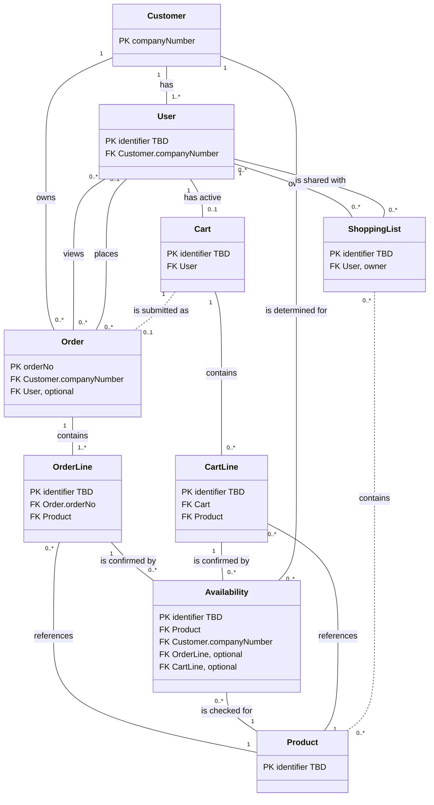

# ABB EasyOrder (China) — Industrial B2B e-commerce

*Moves from broad to narrow: the industry domain, then this product's scope and data model (entities, keys, relationships, rules), then the systems it works with, then the decisions, assumptions, and open questions behind it. Research-led and validated with the stakeholder; updated as understanding deepens.*

| | |
|---|---|
| **Domain** | Industrial B2B e-commerce (manufacturer direct ordering) |
| **Client** | ABB — Electrification business |
| **Product** | ABB EasyOrder (EO) — ABB's B2B ordering webshop for its partners' electrical products, built on SAP as the system of record [R1]. In scope: the China deployment, limited to low-voltage products and systems. |

## Part 1 — Domain

*Specific to the industry, not this project — reusable for other clients in the same domain.*

### 1. Domain Primer

#### Core concepts

- **A manufacturer webshop is a front end on the ERP.** It serves the manufacturer's existing B2B partners — such as OEMs, panel builders, and distributors — with catalog search, real-time price and availability, pricing and discounts, order history and tracking, business documentation, and product configuration [R1][R2]. The commercial truth (customer, price, stock, order) lives in the ERP, typically SAP; the webshop presents it and submits orders back.
- **Customer = sold-to party.** In SAP Sales & Distribution, the sold-to party is the company that places the order. Other *partner functions* attach to each order: ship-to party (receives goods), bill-to party (receives the invoice), and payer. Creating a sold-to master record automatically assigns these functions to it, and by default one partner is assigned per function [R5]. A webshop's delivery and invoice addresses are these partner functions seen from the order.
- **Price and supply are per customer.** In B2B, the same product can carry a different price and a different supply for each customer (interview). In SAP, customer-specific conditions such as prices and rebates are maintained per *sales area* — a sales organization, distribution channel, and division [R7] — and availability is checked against the delivering plant for that customer's order [R6]. So "the price" or "the stock" of a product only has meaning for a given customer.
- **Availability = available-to-promise (ATP).** SAP checks whether stock at the delivering plant covers the requirement on the requested date. If it does, the quantity is reserved and appears as a *confirmed schedule line*; if not, SAP searches forward for the next feasible date, and an item that cannot be covered stays unconfirmed. Only confirmed schedule lines can be delivered [R6].
- **Configurable products.** SAP handles these as variant-configurable materials: features are characteristics with allowed values, the buyer's chosen values are stored on the sales order item, dependencies block invalid combinations, and both price and availability can depend on the configuration [R8].
- **Reusable lists.** B2B platforms call them *requisition lists*: a buyer can keep several lists, add items to the cart directly from a list, and share a list only with colleagues in the same company [R9].

#### How the industry typically models this

- **The company owns everything.** One company account (sold-to) has many users; users act on its behalf, orders belong to the company, and saved lists can be shared only within it [R5][R9].
- **An order is three levels deep:** a header (sold-to, partner functions, PO number, dates, status) → items (material, quantity, price, configuration) → schedule lines carrying confirmed quantities and dates [R5][R6][R8].
- **Price and availability** are retrieved in real time per item and per customer, for one or many products [R3].
- **The cart is filled** by article number, file upload, a saved list or cart, or directly from a configurator using a configuration ID or reference [R3][R4].
- **Orders are tracked** through their status, optionally with deliveries carrying carrier track-and-trace [R3]; the order list can cover every order the company placed, including those placed outside the webshop [R4].

#### Common variations / design choices

- **Partner functions:** full entities picked from master data vs. simple address fields on the order.
- **Availability granularity:** one yes/no per check vs. multiple confirmations per item.
- **Cart persistence:** session-only vs. saved carts.
- **Order visibility:** only webshop-placed orders vs. every order of the company regardless of channel [R4].
- **Delivery tracking:** order status only vs. delivery/shipment entities with carrier tracking [R3][R4].

*This product's choices on these variations are recorded in Decisions & Assumptions.*

## Part 2 — Product

*Specific to this product: its scope, entities, keys, relationships, and rules.*

### 2. Scope & Context

| Field | Value |
|---|---|
| End Users / Personnel | Customer users (B2B buyers under a company account, with a fixed set of roles) |
| Journeys & Use Cases | **Product Catalog & Search:** search and view products; configure configurable products **Price & Availability Check:** check price and availability for a requested quantity **Cart & Ordering:** add to cart and place an order (PO number, ship-to, invoice-to, end user); save and share shopping lists **Order View & Tracking:** view and track the Customer's orders |
| Inputs | Customer's purchasing need (products, quantities); customer-specific price, discount, and stock; product data; product configurations |
| Outputs / Ultimate Outcomes | Sales order created in SAP with confirmed price and delivery; order status visible to the customer |
| Out of Scope | ABB internal users or sales groups (not part of the core journey); SAP itself (backend, data source, and staff interface for order management); Reporting & Documentation; News & Announcements; Admin; standalone price management; product category hierarchy; Global/West Europe deployment; platform architecture |
| Constraints | China market only; low-voltage products and systems (低压产品及系统) only; separate China deployment for regulatory reasons |

*Which system supplies each input, data ownership, and data flows are in System Landscape.*

### 3. Entities Inventory

| ID | Entity Name | Description | Source Type | Status |
|---|---|---|---|---|
| E01 | Customer | B2B company buying through EasyOrder China; same concept as "Account". Industry equivalent: SAP sold-to party. | Interview; Research [R1][R5] | Confirmed |
| E02 | User | Customer-side person who signs in under exactly one Customer with one of a fixed set of roles; can order and see that Customer's orders. Industry equivalent: company user. | Interview; Research [R9] | Confirmed |
| E03 | Product | Low-voltage product or system sold via EasyOrder China; same concept as "SKU". Data sourced from SAP (primary) or PIS (alternative). Industry equivalent: SAP material. | Interview; Doc: architecture.md §6 | Confirmed |
| E04 | Cart | The User's single active working cart, from which an Order is placed. | Interview (D4); Research [R4] | Confirmed |
| E05 | Cart Line | Line item of a Cart: one Product with its own requested quantity, price, availability, and other line-level data. | Interview | Confirmed |
| E06 | Order | Customer order created in SAP and viewed/tracked in EO — whether placed in EO or through another channel. Industry equivalent: SAP sales order. | Interview (D8); Research [R5]; Doc: architecture.md §7 | Confirmed |
| E07 | Order Line | Line item of an Order: one Product with requested quantity, price, discount, and (for configurable products) its configuration. Industry equivalent: sales order item. | Interview; Research [R5][R8] | Confirmed |
| E08 | Availability | One availability confirmation for a requested quantity of a Product: quantity confirmed, shipping plant, and date. A Cart Line or Order Line can have several. Industry equivalent: ATP confirmed schedule line. | Interview (D2); Research [R6] | Confirmed |
| E09 | Shopping List | Saved, reusable list of Products owned by one User; shareable manually with Users of the same Customer only. Industry equivalent: requisition list. | Interview; Research [R9] | Confirmed |

### 4. Domain Model Diagram

*Entities with their keys only — PK = primary key, FK = foreign key (referenced entity shown); other attributes are listed in Attributes. "identifier TBD" = not yet captured (OQ 8). Solid lines = confirmed relationships; dashed lines = assumed (†, see Decisions & Assumptions). Cardinalities match Relationships.*

### 5. Attributes

*One line per entity. PK = primary key; types and descriptions are given only where not obvious from the name. Foreign keys follow from Relationships. Identifiers not yet captured for User, Product, Cart, Cart Line, Order Line, Availability, and Shopping List (OQ 8).*

- **E01 Customer** — `companyNumber` (PK; SAP customer number, C2) · `companyName`
- **E02 User** — `role` (enum; values open — OQ 2)
- **E03 Product** — `configurable` (yes/no; configured via E Configure) · other attributes not confirmed yet (OQ 5)
- **E04 Cart** — no own attributes
- **E05 Cart Line / E07 Order Line** — `requestedQuantity` · `price` · `discount` · `configuration` (only when Product is configurable — C6)
- **E06 Order** — `orderNo` (PK; SAP-generated) · `poNumber` · `orderCreationDate` · `status` (enum; values open — OQ 1) · `addressTo` (ship-to, D1) · `invoiceTo` (bill-to, D1) · `endUser`
- **E08 Availability** — `inStock` · `confirmedQuantity` · `confirmedDate` · `shippingPlant` (D7)
- **E09 Shopping List** — no attributes confirmed yet (OQ 4)

### 6. Relationships

*Grouped by area. Each relationship reads left to right, followed by its cardinality as **A : B** — how many A relate to one B, then how many B relate to one A. † = assumed, not yet confirmed (see Decisions & Assumptions).*

**Cardinality notation:** `1` = exactly one · `0..1` = zero or one · `1..*` = one or more · `0..*` = zero or more

- **Customer and users**
  - Customer → **has** → User `1 : 1..*` — minimum assumed (A4); could be `0..*`
  - Customer → **owns** → Order `1 : 0..*`
  - User → **views** → Order `0..* : 0..*` — derived, not stored: follows from the Customer owning the Order (C9)
  - User → **places** → Order `0..1 : 0..*` — no User for Orders placed outside EO
- **Orders**
  - Order → **contains** → Order Line `1 : 1..*`
  - Order Line → **references** → Product `0..* : 1`
  - Order Line → **is confirmed by** → Availability `1 : 0..*`
- **Availability**
  - Availability → **is checked for** → Product `0..* : 1`
  - Availability → **is determined for** → Customer `0..* : 1` — supply varies per Customer (C12)
- **Cart**
  - User → **has active** → Cart `1 : 0..1`
  - Cart → **contains** → Cart Line `1 : 0..*`
  - Cart Line → **references** → Product `0..* : 1`
  - Cart Line → **is confirmed by** → Availability `1 : 0..*`
  - Cart → **is submitted as** → Order `1 : 0..1` † (A1)
- **Shopping lists**
  - User → **owns** → Shopping List `1 : 0..*`
  - Shopping List → **is shared with** → User `0..* : 0..*` — same Customer only (C7)
  - Shopping List → **contains** → Product `0..* : 0..*` † (A2)

### 7. Business Rules / Constraints

| ID | Constraint | Entities Involved | Description | Source Type | Status |
|---|---|---|---|---|---|
| C1 | Single customer membership | User, Customer | Every User belongs to exactly one Customer. | Interview | Confirmed |
| C2 | Customer identity | Customer | A Customer is identified by its companyNumber. | Interview | Confirmed |
| C3 | Fixed role set | User | User.role must be one of a fixed set of roles. | Interview | Confirmed |
| C4 | Product scope | Product | Products are limited to low-voltage products and systems. | Interview | Confirmed |
| C5 | Order has lines | Order, Order Line | An Order must contain at least one Order Line. | Interview; Research [R5] | Confirmed |
| C6 | Configuration only on configurable lines | Cart Line, Order Line, Product | A line's configuration is present only when the referenced Product is configurable. | Interview; Research [R8] | Confirmed |
| C7 | Shopping List ownership and sharing boundary | Shopping List, User, Customer | A Shopping List is owned by exactly one User, is private unless manually shared, and can be shared only with Users of the same Customer. | Interview; Research [R9] | Confirmed |
| C8 | One active cart | User, Cart | A User has at most one active Cart. | Interview (D4) | Confirmed |
| C9 | Customer-wide order visibility | User, Order, Customer | A User can view all Orders of their own Customer, including Orders not placed in EO — and no Orders of other Customers. | Interview (D8); Research [R4] | Confirmed |
| C10 | SAP is system of record | Order, Order Line, Availability, Product | Price, discount, availability confirmations, order number, and order status originate from SAP; product data comes from SAP (primary) or PIS (alternative). The availability source conflicts with architecture.md and is open (OQ 6). | Interview; Doc: architecture.md §6–7 | Confirmed |
| C11 | Confirmations within request | Cart Line, Order Line, Availability | The sum of confirmedQuantity across a line's Availability confirmations does not exceed its requestedQuantity. | Research [R6] | Proposed |
| C12 | Customer-specific price and supply | Customer, Product, Cart Line, Order Line, Availability | A Product's price and availability are determined per Customer; the same Product can have a different price and supply for different Customers. | Interview; Research [R7] | Confirmed |
| C13 | One line per confirmation | Availability, Order Line, Cart Line | Each Availability confirmation belongs to exactly one line — either an Order Line or a Cart Line, never both or neither. | Interview (derived from Relationships) | Proposed |

## Part 3 — System Landscape

*Specific to how the product is realised: the systems it interacts with, which data each owns, and how data flows between them. Systems and data flows only — integration detail beyond the type of integration is platform architecture, which is out of scope.*

### 8. System Landscape

#### Systems

*Entities owned by an out-of-scope system are modelled as read-only reflections of that system. † = assumed, not yet confirmed (see Decisions & Assumptions).*

| System | Role | In Scope? | System of Record For |
|---|---|---|---|
| EasyOrder (EO) | Customer-facing webshop; orchestrates the other systems | Yes | Cart, Cart Line, User, Shopping List † (A5) |
| SAP | ERP back end: order creation, order data, fulfilment | No — integration only | Customer; Order, Order Line; price and discount; availability confirmations |
| PIS | Product information service | No — integration only | Product data (alternative source; SAP is primary) |
| E Configure | Product configurator | No — integration only | Configuration model; the buyer's chosen values are stored on Cart Line / Order Line (D5) |
| CBOL | Legacy platform; still serves some pages and China order management | ? (OQ 7) | ? (OQ 7) |
| Identity provider † | Authenticates users at sign-in | No — integration only | User credentials (A8) |

#### Data flows

*Direction is relative to EO. Integration types come from architecture.md §6.1 and are not yet confirmed by the technical team. ? = not yet known.*

- **Upstream — into EO**
  - SAP → EO: Customer; price and discount; Availability confirmations; Order and Order Line data, including status — `synchronous API + async processing`
  - PIS → EO: Product data (alternative to SAP); architecture.md also routes availability through PIS, conflicting with C10 (OQ 6) — `API / data service`
  - E Configure → EO: product configuration — `configuration API`
  - Identity provider → EO: user authentication — integration type ?
- **Downstream — out of EO**
  - EO → SAP: Orders submitted from the Cart, created in SAP — `synchronous API + async processing`
- **Unclear**
  - EO ↔ CBOL: users are routed between EO and CBOL, and China order management sits in CBOL; which data flows, and in which direction, is unknown (OQ 7) — `redirect / session handoff`

## Part 4 — Supporting Information

*The decisions and assumptions behind the model, open items, sources, and document history.*

### 9. Decisions & Assumptions

*Decided: modelling choices made where industry practice varies — what was decided, and why. Assumptions: what the model currently treats as true without confirmation — what is assumed, and what would confirm it.*

#### Decided

- **D1 — Ship-to and invoice-to are fields on the Order**, rather than separate partner entities from SAP master data.
  *Why:* separate partner entities are too granular for this model.
- **D2 — An Order Line can have several Availability confirmations**, rather than one yes/no result.
  *Why:* SAP confirms stock as schedule lines, so a requested quantity can be partly confirmed on different dates [R6].
- **D3 — Price and discount are attributes of the line**, rather than a separate Price entity.
  *Why:* SAP returns price per line for the Customer (C10), and standalone price management is out of scope.
- **D4 — Each User has one active Cart, saved between sessions**, rather than a session-only cart.
  *Why:* to be confirmed (OQ 9).
- **D5 — The chosen configuration is stored on the line as structured values**, rather than as a separate Configuration entity.
  *Why:* E Configure owns the configuration model (System Landscape); the order only needs the buyer's chosen values, as in SAP [R8].
- **D6 — Orders are tracked by status only**, rather than with delivery and shipment details.
  *Why:* to be confirmed (OQ 9).
- **D7 — The shipping plant is an attribute of an Availability confirmation**, rather than a separate Plant entity.
  *Why:* to be confirmed (OQ 9).
- **D8 — Users see all Orders of their Customer, from any channel**, rather than only Orders they placed in EO.
  *Why:* Orders belong to the Customer, and customers also order through other channels (C9).

#### Assumptions

- **A1 — A Cart is submitted as at most one Order.**
  *Confirm:* stakeholder to confirm the Cart → Order relationship (shown † in Relationships).
- **A2 — A Shopping List contains Products.**
  *Confirm:* stakeholder to confirm what a Shopping List holds (shown † in Relationships; see also OQ 4).
- **A3 — A line's confirmed quantities never exceed its requested quantity** (C11).
  *Confirm:* check with the SAP team; currently based on research only [R6].
- **A4 — A Customer has at least one User** (the `1..*` minimum).
  *Confirm:* stakeholder to confirm whether a Customer can exist with no Users.
- **A5 — EO is the system of record for Cart, Cart Line, User, and Shopping List.**
  *Confirm:* technical team to confirm data ownership; Cart and Cart Line are supported by architecture.md §5, User and Shopping List by no source yet.
- **A6 — A configurable Product must be configured before it is added to the Cart.**
  *Confirm:* stakeholder to confirm; currently implied by architecture.md §6.1.
- **A7 — Ship-to is set once per Order, not per line.**
  *Confirm:* stakeholder to confirm; SAP allows a different ship-to per item [R5].
- **A8 — Users sign in through a separate identity provider, which holds their credentials.**
  *Confirm:* technical team to confirm; currently based on the authentication flow in architecture.md §7.
- **A9 — Each Availability confirmation belongs to exactly one line, an Order Line or a Cart Line** (C13).
  *Confirm:* stakeholder or technical team to confirm whether a confirmation can be carried over from a Cart Line to the Order Line created from it.

### 10. Open Questions

1. **Order status values:** which statuses does EO China show?
2. **Role names:** what are the fixed User roles?
3. **Customer types:** ABB lists OEMs, panel builders, and distribution-channel buyers as EasyOrder users [R1]. Do these matter as Customer subtypes, or are they out of scope?
4. **Shopping List:** can shared recipients edit or only view/copy? Can a list be empty? Does it have a name?
5. **Product attributes:** none confirmed (e.g., product number, description, unit of measure); when does PIS replace SAP as the product data source?
6. **Availability source conflict:** C10 (interview) says availability comes from SAP, while architecture.md §6.1 and §6.3 route availability through PIS ("or SAP depending flow"). Which applies to EO China?
7. **CBOL's role in China:** architecture.md §7 says China order management is "managed by CBOL". Is CBOL in scope as a source of Orders for EO China, and does it own any data here?
8. **Identifiers:** what uniquely identifies a User, Product, Cart, Cart Line, Order Line, Availability confirmation, and Shopping List? Only Customer (companyNumber) and Order (orderNo) have confirmed identifiers.
9. **Rationale for D4, D6, D7:** why were these decided? Proposed: D4 — buyers build orders over time and need to return to them; D6 — the in-scope journey covers order status, not shipment tracking; D7 — the plant is only shown as information on a confirmation, and no plant-level data is in scope.

### 11. Reference Sources

*Sources cited as [R#] in this document.*

- **R1** [ABB EasyOrder](https://new.abb.com/about/our-businesses/electrification/abb-easyorder)
- **R2** [ABB EasyOrder (German)](https://new.abb.com/low-voltage/de/support/ABB-EasyOrder)
- **R3** [mySchneider](https://www.se.com/my/en/work/support/myschneider)
- **R4** [Siemens Industry Mall](https://www.siemens.com/en-us/content/e-business-hungary/industry-mall/)
- **R5** [Partner Functions (SD)](https://help.sap.com/saphelp_470/helpdata/en/7f/f63420ac6111d2b44c006094b9ea37/content.htm)
- **R6** [Running an Available-to-Promise (ATP) Check in SAP S/4HANA Sales](https://learning.sap.com/learning-journeys/applying-sap-s-4hana-sales/running-an-available-to-promise-atp-check-in-sap-s-4hana-sales_a2b4c5e3-1618-418d-a4f6-efe5ff43f7f1)
- **R7** [Sales Area / Organizational Structure in Sales](https://help.sap.com/saphelp_470/helpdata/EN/12/08423e470311d1894a0000e8323352/content.htm)
- **R8** [Configurable Materials in Sales Documents](https://help.sap.com/saphelp_46c/helpdata/en/1e/448b538d7e11d183730000e8a49aad/content.htm)
- **R9** [Introduction to Adobe Commerce B2B (requisition lists, company accounts)](https://experienceleague.adobe.com/en/docs/commerce-admin/b2b/introduction)

### 12. Document Control & Revision History

| Field | Value |
|---|---|
| Status | Draft |

**Revision History**

| Version | Date | Change Description |
|---|---|---|
| 1.0 | 2026-10-13 | Initial interview-based draft (superseded) |
| 2.0 | 2026-10-13 | Rebuilt with the research-led method (primer, sources, Source Type/Status per row); multiple availability confirmations per Order Line; all Customer orders visible, incl. those placed outside EO; decision points D1–D8 resolved |
| 2.1 | 2026-10-13 | Stakeholder validation: User split into Customer/Internal; Cart Line added; Customer keyed by companyNumber; orderNo merged with SAP orderId; Plant kept as an attribute (D7) |
| 2.2 | 2026-10-14 | Internal users removed from scope; companyNumber confirmed as the SAP customer number; Cart Line discount and configuration confirmed |
| 3.0 | 2026-10-19 | Restructured into Domain, Product, System Landscape, and Supporting parts; model simplified; decisions and assumptions separated; Sales Office removed; Product subtypes became an attribute; IDs renumbered; title and header simplified |
