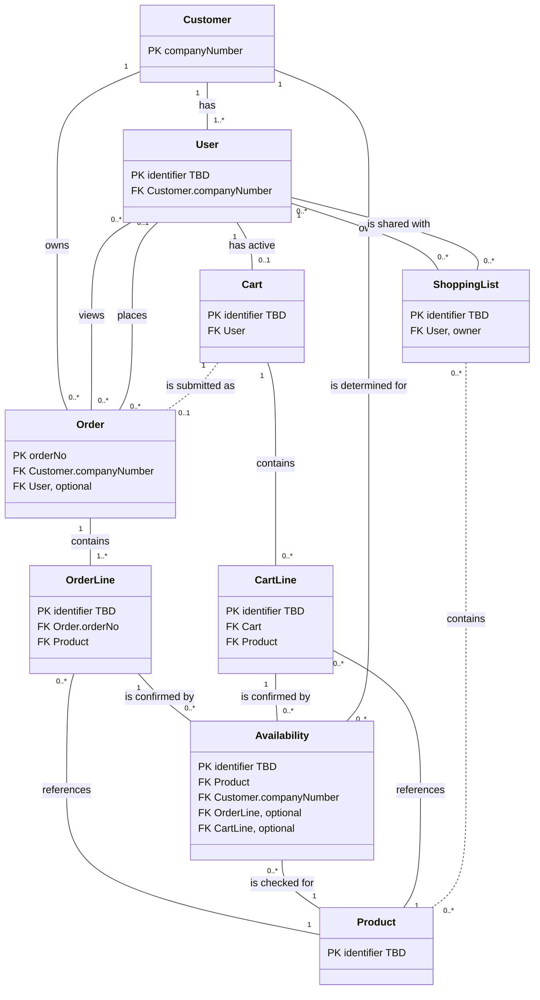

# ABB EasyOrder (China) — Electrical Equipment B2B Sales

*Moves from broad to narrow: the sector of the domain the product sits in, then this product's scope and data model (entities, keys, relationships, rules), then the systems it works with, then the decisions, assumptions, and open questions behind it. Research-led and validated with the stakeholder; updated as understanding deepens.*

| | |
|---|---|
| **Domain** | Electrical equipment manufacturing |
| **Sector** | B2B sales |
| **Client** | ABB |
| **Project Code** | eocn — PRD: not yet created |
| **Product** | ABB EasyOrder (EO) — ABB's B2B webshop where its partners order ABB electrical products, built on SAP as the system of record [R1]. In scope: the China deployment, limited to low-voltage products and systems. |

## Part 1 — Sector

*Specific to the B2B sales sector of electrical equipment manufacturing, not this project — reusable for other clients in the same sector.*

### 1. Sector Primer

*Plain-language explainer for readers new to the sector: an overview of the sector, its core concepts, how the sector typically models them, and where real implementations commonly differ.*

#### Sector overview

- **Scope:** how companies that make electrical equipment sell it to other businesses, not to consumers — who they sell through, how prices are set, how orders are placed, and how an order becomes a delivery and a paid invoice. Other parts of the same industry sit alongside it: designing and making the products, installing them on site, and servicing them afterwards [R12][R14].
- **Participants:**
  - *Manufacturers* make the equipment.
  - *Distributors* (wholesalers) buy from many manufacturers, keep stock, and resell to contractors and industrial buyers.
  - *Panel builders* assemble electrical cabinets and switchboards from components; *OEMs* (original equipment manufacturers) build components into their own machines.
  - *System integrators* combine products from several makers into one working solution.
  - *Electrical contractors* install the equipment in buildings and industrial sites.
  - *End users* — building owners, factories, infrastructure operators — run it.
  - *Standards bodies and certification authorities* set the safety rules products must meet [R12][R14][R22].
- **Core transactions:**
  - Manufacturers sell to these partners, and each partner can pay a different price.
  - Distributors resell from their stock to contractors and industrial buyers.
  - Panel builders and OEMs buy components, turn them into cabinets or machines, and sell those on.
  - Orders come in through sales staff, online shops, or straight from the buyer's own purchasing system. The manufacturer confirms what it can deliver and when, ships the goods, then invoices and gets paid [R12][R16][R18][R20].

#### Core concepts

- **Who buys and sells**
  - **Selling through partners.** Manufacturers sell much of their equipment to partner businesses, not to the people who finally use it. Each kind of partner buys for its own reason: distributors to resell, panel builders and OEMs to build the parts into something bigger, system integrators to put together a complete solution, and contractors to install [R12][R13][R14].
  - **Through distributors or direct.** Many products go from the manufacturer to a distributor, and from the distributor to a contractor or end user — called *two-step distribution*. The distributor brings together products from many manufacturers and supplies them to contractors and industrial buyers [R12]. When a manufacturer also sells direct, for example through its own online shop, it competes with its own distributors. This *channel conflict* is often handled with separate price lists, or by keeping products that distributors sell off the manufacturer's own shop [R15].
- **What is sold**
  - **Parts vs. assembled units.** A *component* is a single part, such as a circuit breaker (a switch that cuts the power when something goes wrong). An *assembly* is a larger unit built from many components, such as a switchboard. Safety standards make the company that designs an assembly and the company that builds it each responsible for its own share of the work [R10][R11].
  - **Standard vs. configurable products.** A standard product is bought as it is, straight from the catalogue. A *configurable* product is ordered with options the buyer picks; only certain combinations are allowed, and the choice can change the price and how soon it can be delivered [R8].
  - **Shared product descriptions.** Manufacturers describe their products in an industry-wide classification. Each product sits in one category with a fixed list of technical features, each with a value and unit, so buyers can search and compare products from different makers [R19].
- **From order to payment**
  - **Each buyer has its own price.** Business buyers rarely pay the list price. The manufacturer gives each buyer, or group of buyers, a *multiplier* — a factor that turns the list price into that buyer's price (a multiplier of 0.6 means 60% of the list price). For particular projects it can agree an even lower *special price* [R16][R17]. So a product has no single price; it depends on who is buying.
  - **The steps of a sale.** A sale usually goes through these steps: the buyer asks (*inquiry*), the manufacturer offers a price (*quotation*), the buyer orders (*sales order*), the goods are delivered, an invoice is sent, and the buyer pays. Placing the order doesn't move money or stock yet; that happens when the goods leave the warehouse and when the invoice is issued [R18].
  - **Promising a delivery date.** When an order comes in, the manufacturer checks whether it has enough stock for the requested date, then tells the buyer how much it can deliver and when. Whatever it can't cover gets a later date or no date yet, so one order line may arrive in several parts [R6].
  - **Ordering computer to computer.** Large buyers often don't type orders in by hand. With *EDI* (electronic data interchange), the buyer's and seller's systems send each other orders, order confirmations, and invoices automatically. With *punchout*, the buyer opens the supplier's catalogue from inside its own purchasing system, fills a cart, and sends it back there for approval [R20][R21].
- **Safety rules and approvals**
  - **Safety standards.** Electrical equipment has to be designed and tested to agreed safety standards. Many come from the *IEC* (International Electrotechnical Commission), and countries copy them into their own national standards — for example IEC 60947 for low-voltage (up to 1,000 V) switches and similar parts, and IEC 61439 for low-voltage switchboards [R10][R25]. *In China:* the national GB/T 14048 series is based on IEC 60947 [R25].
  - **Approval before sale.** Many markets require a product to be shown to meet local rules and to carry an approval mark before it can be sold, and importers and distributors must check for the mark. In the EU, for example, this is the *CE mark* for equipment rated from 50 to 1,000 V AC [R22]. *In China:* listed low-voltage products need the compulsory *CCC mark*, and since November 2024 low-voltage components must again be tested by an approved outside body rather than self-declared by the manufacturer [R23][R24].

#### How the sector typically models this

- **The online shop sits on top of the main business system.** The shop lets existing partners search the catalogue, see live prices and stock, configure products, and look up past orders and documents [R1][R2]. The real records — customers, prices, stock, orders — are kept in the company's main business system (*ERP*, enterprise resource planning; often SAP), and orders placed in the shop are sent back to it.
- **The customer is the buying company, not the person.** One company account has many users who order on its behalf, and the orders belong to the company [R9]. The company that orders is called the *sold-to party*. Each order also names who receives the goods (*ship-to*), who gets the invoice (*bill-to*), and who pays (*payer*) — usually one of each [R5].
- **Price and stock are worked out for each buyer.** Buyer-specific prices and discounts are set per *sales area* — the combination of selling unit, sales channel, and product division [R7]. Stock is checked at the site that will ship the order (*delivering plant*) [R6]. Both are looked up live, line by line, for one or many products at once [R3].
- **An order has three levels.** The *header* holds what applies to the whole order: buyer, addresses, purchase order number, dates, and status. Each *item* is one product with its quantity, price, and chosen options. Under each item, *schedule lines* say how much will be delivered on which date; only confirmed schedule lines can be shipped [R5][R6][R8].
- **Chosen options are saved on the order item.** A configurable product has a set of features, each with allowed values. Rules block combinations that don't work, and the buyer's choices are stored with the order item [R8].
- **Carts are filled in several ways:** typing article numbers, uploading a file, reusing a saved list or cart, or sending a product straight from the configurator [R3][R4]. A buyer can keep several saved lists (*requisition lists*), add items to the cart from them, and share them only with colleagues in the same company [R9].
- **Orders are followed by status.** Buyers see where each order stands, sometimes with delivery tracking from the carrier [R3]. The order list can show every order the company placed, including those placed outside the online shop [R4].

#### Common variations / design choices

- **Delivery and invoice addresses:** picked from the buyer's stored records (ship-to, bill-to) vs. typed as simple address fields on the order.
- **Stock answer:** a single "in stock / not in stock" vs. several confirmations per order line, each with its own quantity and date.
- **Cart:** cleared when the user leaves vs. saved so the user can come back to it.
- **Which orders a buyer sees:** only orders placed in the online shop vs. every order of the company, however it was placed [R4].
- **Delivery tracking:** order status only vs. separate delivery records with tracking from the carrier [R3][R4].

*This product's choices on these variations are recorded in Decisions & Assumptions.*

## Part 2 — Product

*Specific to this product: its scope, entities, keys, relationships, and rules.*

### 2. Scope & Context

| Field | Value |
|---|---|
| End Users / Personnel | Customer users (B2B buyers under a company account, with a fixed set of roles) |
| Journeys & Use Cases | **Product Catalog & Search:** search and view products; configure configurable products **Price & Availability Check:** check price and availability for a requested quantity **Cart & Ordering:** add to cart and place an order (buyer's purchase order number, ship-to, invoice-to, end user); save and share shopping lists **Order View & Tracking:** view and track the Customer's orders |
| Inputs | Customer's purchasing need (products, quantities); customer-specific price, discount, and stock; product data; product configurations |
| Outputs / Ultimate Outcomes | Sales order created in SAP with confirmed price and delivery; order status visible to the customer |
| Out of Scope | ABB internal users or sales groups (not part of the core journey); SAP itself (back end, data source, and staff interface for order management); Reporting & Documentation; News & Announcements; Admin; standalone price management; product category hierarchy; Global/West Europe deployment; platform architecture |
| Constraints | China market only; low-voltage products and systems (低压产品及系统) only; separate China deployment for regulatory reasons |

*Which system supplies each input, data ownership, and data flows are in System Landscape.*

### 3. Entities Inventory

| ID | Entity Name | Description | Source Type | Status |
|---|---|---|---|---|
| E01 | Customer | B2B company buying through EasyOrder China; same concept as "Account". Industry equivalent: SAP sold-to party. | Interview; Research [R1][R5] | Confirmed |
| E02 | User | Customer-side person who signs in under exactly one Customer with one of a fixed set of roles; can order and see that Customer's orders. Industry equivalent: company user. | Interview; Research [R9] | Confirmed |
| E03 | Product | Low-voltage product or system sold via EasyOrder China; same concept as "SKU" (stock-keeping unit). Data sourced from SAP (primary) or PIS (alternative). Industry equivalent: SAP material (SAP's term for a product). | Interview; Doc: architecture.md §6 | Confirmed |
| E04 | Cart | The User's single active working cart, from which an Order is placed. | Interview (D4); Research [R4] | Confirmed |
| E05 | Cart Line | Line item of a Cart: one Product with its own requested quantity, price, availability, and other line-level data. | Interview | Confirmed |
| E06 | Order | Customer order created in SAP and viewed/tracked in EO — whether placed in EO or through another channel. Industry equivalent: SAP sales order. | Interview (D8); Research [R5]; Doc: architecture.md §7 | Confirmed |
| E07 | Order Line | Line item of an Order: one Product with requested quantity, price, discount, and (for configurable products) its configuration. Industry equivalent: sales order item. | Interview; Research [R5][R8] | Confirmed |
| E08 | Availability | One availability confirmation for a requested quantity of a Product: quantity confirmed, shipping plant, and date. A Cart Line or Order Line can have several. Industry equivalent: confirmed schedule line from an available-to-promise (ATP) stock check. | Interview (D2); Research [R6] | Confirmed |
| E09 | Shopping List | Saved, reusable list of Products owned by one User; shareable manually with Users of the same Customer only. Industry equivalent: requisition list. | Interview; Research [R9] | Confirmed |

### 4. Domain Model Diagram

*Entities with their keys only — PK = primary key, FK = foreign key (referenced entity shown); other attributes are listed in Attributes. "identifier TBD" = not yet captured (OQ 8). Solid lines = confirmed relationships; dashed lines = assumed (†, see Decisions & Assumptions). Cardinalities match Relationships.*

### 5. Attributes

*One line per entity. PK = primary key; types and descriptions are given only where not obvious from the name. Foreign keys follow from Relationships. Identifiers not yet captured for User, Product, Cart, Cart Line, Order Line, Availability, and Shopping List (OQ 8).*

- **E01 Customer** — `companyNumber` (PK; SAP customer number, C2) · `companyName`
- **E02 User** — `role` (enum; values open — OQ 2)
- **E03 Product** — `configurable` (yes/no; configured via E Configure) · other attributes not confirmed yet (OQ 5)
- **E04 Cart** — no own attributes
- **E05 Cart Line / E07 Order Line** — `requestedQuantity` · `price` · `discount` · `configuration` (only when Product is configurable — C6)
- **E06 Order** — `orderNo` (PK; SAP-generated) · `poNumber` · `orderCreationDate` · `status` (enum; values open — OQ 1) · `addressTo` (ship-to, D1) · `invoiceTo` (bill-to, D1) · `endUser`
- **E08 Availability** — `inStock` · `confirmedQuantity` · `confirmedDate` · `shippingPlant` (D7)
- **E09 Shopping List** — no attributes confirmed yet (OQ 4)

### 6. Relationships

*Grouped by area. Each relationship reads left to right, followed by its cardinality as **A : B** — how many A relate to one B, then how many B relate to one A. † = assumed, not yet confirmed (see Decisions & Assumptions).*

**Cardinality notation:** `1` = exactly one · `0..1` = zero or one · `1..*` = one or more · `0..*` = zero or more

- **Customer and users**
  - Customer → **has** → User `1 : 1..*` — minimum assumed (A4); could be `0..*`
  - Customer → **owns** → Order `1 : 0..*`
  - User → **views** → Order `0..* : 0..*` — derived, not stored: follows from the Customer owning the Order (C9)
  - User → **places** → Order `0..1 : 0..*` — no User for Orders placed outside EO
- **Orders**
  - Order → **contains** → Order Line `1 : 1..*`
  - Order Line → **references** → Product `0..* : 1`
  - Order Line → **is confirmed by** → Availability `1 : 0..*`
- **Availability**
  - Availability → **is checked for** → Product `0..* : 1`
  - Availability → **is determined for** → Customer `0..* : 1` — supply varies per Customer (C12)
- **Cart**
  - User → **has active** → Cart `1 : 0..1`
  - Cart → **contains** → Cart Line `1 : 0..*`
  - Cart Line → **references** → Product `0..* : 1`
  - Cart Line → **is confirmed by** → Availability `1 : 0..*`
  - Cart → **is submitted as** → Order `1 : 0..1` † (A1)
- **Shopping lists**
  - User → **owns** → Shopping List `1 : 0..*`
  - Shopping List → **is shared with** → User `0..* : 0..*` — same Customer only (C7)
  - Shopping List → **contains** → Product `0..* : 0..*` † (A2)

### 7. Business Rules / Constraints

| ID | Constraint | Entities Involved | Description | Source Type | Status |
|---|---|---|---|---|---|
| C1 | Single customer membership | User, Customer | Every User belongs to exactly one Customer. | Interview | Confirmed |
| C2 | Customer identity | Customer | A Customer is identified by its companyNumber. | Interview | Confirmed |
| C3 | Fixed role set | User | User.role must be one of a fixed set of roles. | Interview | Confirmed |
| C4 | Product scope | Product | Products are limited to low-voltage products and systems. | Interview | Confirmed |
| C5 | Order has lines | Order, Order Line | An Order must contain at least one Order Line. | Interview; Research [R5] | Confirmed |
| C6 | Configuration only on configurable lines | Cart Line, Order Line, Product | A line's configuration is present only when the referenced Product is configurable. | Interview; Research [R8] | Confirmed |
| C7 | Shopping List ownership and sharing boundary | Shopping List, User, Customer | A Shopping List is owned by exactly one User, is private unless manually shared, and can be shared only with Users of the same Customer. | Interview; Research [R9] | Confirmed |
| C8 | One active cart | User, Cart | A User has at most one active Cart. | Interview (D4) | Confirmed |
| C9 | Customer-wide order visibility | User, Order, Customer | A User can view all Orders of their own Customer, including Orders not placed in EO — and no Orders of other Customers. | Interview (D8); Research [R4] | Confirmed |
| C10 | SAP is system of record | Order, Order Line, Availability, Product | Price, discount, availability confirmations, order number, and order status originate from SAP; product data comes from SAP (primary) or PIS (alternative). The availability source conflicts with architecture.md and is open (OQ 6). | Interview; Doc: architecture.md §6–7 | Confirmed |
| C11 | Confirmations within request | Cart Line, Order Line, Availability | The sum of confirmedQuantity across a line's Availability confirmations does not exceed its requestedQuantity. | Research [R6] | Proposed |
| C12 | Customer-specific price and supply | Customer, Product, Cart Line, Order Line, Availability | A Product's price and availability are determined per Customer; the same Product can have a different price and supply for different Customers. | Interview; Research [R7] | Confirmed |
| C13 | One line per confirmation | Availability, Order Line, Cart Line | Each Availability confirmation belongs to exactly one line — either an Order Line or a Cart Line, never both or neither. | Interview (derived from Relationships) | Proposed |

## Part 3 — System Landscape

*Specific to how the product is realised: the systems it interacts with, which data each owns, and how data flows between them. Systems and data flows only — integration detail beyond the type of integration is platform architecture, which is out of scope.*

### 8. System Landscape

#### Systems

*Entities owned by an out-of-scope system are modelled as read-only reflections of that system. † = assumed, not yet confirmed (see Decisions & Assumptions).*

| System | Role | In Scope? | System of Record For |
|---|---|---|---|
| EasyOrder (EO) | Customer-facing webshop; orchestrates the other systems | Yes | Cart, Cart Line, User, Shopping List † (A5) |
| SAP | ERP back end: order creation, order data, fulfilment | No — integration only | Customer; Order, Order Line; price and discount; availability confirmations |
| PIS | Product information service | No — integration only | Product data (alternative source; SAP is primary) |
| E Configure | Product configurator | No — integration only | Configuration model; the buyer's chosen values are stored on Cart Line / Order Line (D5) |
| CBOL | Legacy platform; still serves some pages and China order management | ? (OQ 7) | ? (OQ 7) |
| Identity provider † | Authenticates users at sign-in | No — integration only | User credentials (A8) |

#### Data flows

*Direction is relative to EO. Integration types come from architecture.md §6.1 and are not yet confirmed by the technical team. ? = not yet known.*

- **Upstream — into EO**
  - SAP → EO: Customer; price and discount; Availability confirmations; Order and Order Line data, including status — `synchronous API + async processing`
  - PIS → EO: Product data (alternative to SAP); architecture.md also routes availability through PIS, conflicting with C10 (OQ 6) — `API / data service`
  - E Configure → EO: product configuration — `configuration API`
  - Identity provider → EO: user authentication — integration type ?
- **Downstream — out of EO**
  - EO → SAP: Orders submitted from the Cart, created in SAP — `synchronous API + async processing`
- **Unclear**
  - EO ↔ CBOL: users are routed between EO and CBOL, and China order management sits in CBOL; which data flows, and in which direction, is unknown (OQ 7) — `redirect / session handoff`

## Part 4 — Supporting Information

*The decisions and assumptions behind the model, open items, sources, and document history.*

### 9. Decisions & Assumptions

*Decided: modelling choices made where industry practice varies — what was decided, and why. Assumptions: what the model currently treats as true without confirmation — what is assumed, and what would confirm it.*

#### Decided

- **D1 — Ship-to and invoice-to are fields on the Order**, rather than separate partner entities from SAP's stored customer records (master data).
  *Why:* separate partner entities are too granular for this model.
- **D2 — An Order Line can have several Availability confirmations**, rather than one yes/no result.
  *Why:* SAP confirms stock as schedule lines, so a requested quantity can be partly confirmed on different dates [R6].
- **D3 — Price and discount are attributes of the line**, rather than a separate Price entity.
  *Why:* SAP returns price per line for the Customer (C10), and standalone price management is out of scope.
- **D4 — Each User has one active Cart, saved between sessions**, rather than a session-only cart.
  *Why:* to be confirmed (OQ 9).
- **D5 — The chosen configuration is stored on the line as structured values**, rather than as a separate Configuration entity.
  *Why:* E Configure owns the configuration model (System Landscape); the order only needs the buyer's chosen values, as in SAP [R8].
- **D6 — Orders are tracked by status only**, rather than with delivery and shipment details.
  *Why:* to be confirmed (OQ 9).
- **D7 — The shipping plant is an attribute of an Availability confirmation**, rather than a separate Plant entity.
  *Why:* to be confirmed (OQ 9).
- **D8 — Users see all Orders of their Customer, from any channel**, rather than only Orders they placed in EO.
  *Why:* Orders belong to the Customer, and customers also order through other channels (C9).

#### Assumptions

- **A1 — A Cart is submitted as at most one Order.**
  *Confirm:* stakeholder to confirm the Cart → Order relationship (shown † in Relationships).
- **A2 — A Shopping List contains Products.**
  *Confirm:* stakeholder to confirm what a Shopping List holds (shown † in Relationships; see also OQ 4).
- **A3 — A line's confirmed quantities never exceed its requested quantity** (C11).
  *Confirm:* check with the SAP team; currently based on research only [R6].
- **A4 — A Customer has at least one User** (the `1..*` minimum).
  *Confirm:* stakeholder to confirm whether a Customer can exist with no Users.
- **A5 — EO is the system of record for Cart, Cart Line, User, and Shopping List.**
  *Confirm:* technical team to confirm data ownership; Cart and Cart Line are supported by architecture.md §5, User and Shopping List by no source yet.
- **A6 — A configurable Product must be configured before it is added to the Cart.**
  *Confirm:* stakeholder to confirm; currently implied by architecture.md §6.1.
- **A7 — Ship-to is set once per Order, not per line.**
  *Confirm:* stakeholder to confirm; SAP allows a different ship-to per item [R5].
- **A8 — Users sign in through a separate identity provider, which holds their credentials.**
  *Confirm:* technical team to confirm; currently based on the authentication flow in architecture.md §7.
- **A9 — Each Availability confirmation belongs to exactly one line, an Order Line or a Cart Line** (C13).
  *Confirm:* stakeholder or technical team to confirm whether a confirmation can be carried over from a Cart Line to the Order Line created from it.

### 10. Open Questions

1. **Order status values:** which statuses does EO China show?
2. **Role names:** what are the fixed User roles?
3. **Customer types:** ABB lists OEMs, panel builders, and distribution-channel buyers as EasyOrder users [R1]. Do these matter as Customer subtypes, or are they out of scope?
4. **Shopping List:** can shared recipients edit or only view/copy? Can a list be empty? Does it have a name?
5. **Product attributes:** none confirmed (e.g. product number, description, unit of measure); when does PIS replace SAP as the product data source?
6. **Availability source conflict:** C10 (interview) says availability comes from SAP, while architecture.md §6.1 and §6.3 route availability through PIS ("or SAP depending flow"). Which applies to EO China?
7. **CBOL's role in China:** architecture.md §7 says China order management is "managed by CBOL". Is CBOL in scope as a source of Orders for EO China, and does it own any data here?
8. **Identifiers:** what uniquely identifies a User, Product, Cart, Cart Line, Order Line, Availability confirmation, and Shopping List? Only Customer (companyNumber) and Order (orderNo) have confirmed identifiers.
9. **Rationale for D4, D6, D7:** why were these decided? Proposed: D4 — buyers build orders over time and need to return to them; D6 — the in-scope journey covers order status, not shipment tracking; D7 — the plant is only shown as information on a confirmation, and no plant-level data is in scope.

### 11. Reference Sources

*Sources cited as [R#] in this document.*

- **R1** [ABB EasyOrder](https://new.abb.com/about/our-businesses/electrification/abb-easyorder)
- **R2** [ABB EasyOrder (German)](https://new.abb.com/low-voltage/de/support/ABB-EasyOrder)
- **R3** [mySchneider](https://www.se.com/my/en/work/support/myschneider)
- **R4** [Siemens Industry Mall](https://www.siemens.com/en-us/content/e-business-hungary/industry-mall/)
- **R5** [Partner Functions (SD)](https://help.sap.com/saphelp_470/helpdata/en/7f/f63420ac6111d2b44c006094b9ea37/content.htm)
- **R6** [Running an Available-to-Promise (ATP) Check in SAP S/4HANA Sales](https://learning.sap.com/learning-journeys/applying-sap-s-4hana-sales/running-an-available-to-promise-atp-check-in-sap-s-4hana-sales_a2b4c5e3-1618-418d-a4f6-efe5ff43f7f1)
- **R7** [Sales Area / Organizational Structure in Sales](https://help.sap.com/saphelp_470/helpdata/EN/12/08423e470311d1894a0000e8323352/content.htm)
- **R8** [Configurable Materials in Sales Documents](https://help.sap.com/saphelp_46c/helpdata/en/1e/448b538d7e11d183730000e8a49aad/content.htm)
- **R9** [Introduction to Adobe Commerce B2B (requisition lists, company accounts)](https://experienceleague.adobe.com/en/docs/commerce-admin/b2b/introduction)
- **R10** [IEC 61439-1:2020 Low-voltage switchgear and controlgear assemblies — General rules](https://webstore.iec.ch/en/publication/32338)
- **R11** [Hager — IEC 61439 standards guide](https://assets1.sc.hager.com/exports/files/Guide_Normes_IEC_61439_GB_web_sRGB.pdf)
- **R12** [NAED — Intro to Electrical Distribution](https://www.naed.org/intro-to-electrical-distribution)
- **R13** [NAED — Bylaws](https://www.naed.org/hubfs/ByLaws_v2.pdf)
- **R14** [ABB Value Provider Program for channel partners](https://www.abb.com/global/en/channel-partners/authorized-value-provider)
- **R15** [McKinsey — How industrial companies can put e-commerce at the heart of their growth strategy](https://www.mckinsey.com.br/industries/industrials/our-insights/how-industrial-companies-can-put-ecommerce-at-the-heart-of-their-growth-strategy)
- **R16** [Bearing Specialists Association (BSA) — PPIF v2.6 Format and Supplemental Documents](https://www.bsahome.org/hubfs/pdf/PPIFv2.6-Format-and-Supplemental-Documents.pdf)
- **R17** [Deloitte — Special pricing agreements for distributors](https://www.deloitte.com/us/en/industries/consumer/articles/special-pricing-agreements-distributors.html)
- **R18** [SAP Learning — Getting to Know the Order-to-Cash Process](https://learning.sap.com/courses/discovering-the-basics-of-sap-s-4hana-sales/describing-the-order-to-cash-process_e4256fc4-3382-4545-a18e-465b69737b5f)
- **R19** [ETIM International — Classification](https://www.etim-international.com/classification/)
- **R20** [Wesco — eProcurement](https://buy.wesco.com/content/eProcurement)
- **R21** [Digitec Galaxus — E-procurement for B2B ordering](https://www.digitec.ch/en/page/e-procurement-at-digitec-galaxus-for-seamless-b2b-ordering-42525)
- **R22** [Directive 2014/35/EU (Low Voltage Directive)](https://eur-lex.europa.eu/eli/dir/2014/35/oj/eng)
- **R23** [TÜV SÜD — China: Catalogue of products subject to compulsory product certification published](https://www.tuvsud.com/en/e-ssentials-newsletter/consumer-products-and-retail-essentials/e-ssentials-7-2023/china-catalogue-of-products-subject-to-compulsory-product-certification-published)
- **R24** [Nemko — Scope extension of the Chinese compulsory CCC scheme](https://www.nemko.com/blog/scope-extension-of-the-chinese-compulsory-ccc-scheme)
- **R25** [GB/T 14048.3-2017 (adopts IEC 60947-3)](https://www.chinesestandard.net/PDF-EN/GBT14048.3-2017EN-P09P-H7528H-230974.pdf)

### 12. Document Control & Revision History

| Field | Value |
|---|---|
| Status | Draft |

**Revision History**

| Version | Date | Change Description |
|---|---|---|
| 2.0 | 2026-10-13 | Initial draft, rebuilt research-led; decision points D1–D8 resolved; User split into Customer/Internal; Cart Line added; Customer keyed by companyNumber; orderNo merged with SAP orderId |
| 2.1 | 2026-10-14 | Internal users removed from scope; companyNumber confirmed as the SAP customer number; Cart Line discount and configuration confirmed |
| 3.0 | 2026-10-19 | Restructured into Domain, Product, System Landscape, and Supporting parts; model simplified; decisions and assumptions separated; Sales Office removed; Product subtypes became an attribute; IDs renumbered; title and header simplified |
| 4.0 | 2026-10-21 | Keyed to eocn; file renamed; Part 1 reframed to sector (B2B sales), re-researched, in plain language; Part 2 terms spelled out; proofread; sector overview and grouped concepts added; SAP mechanics moved to modelling |
