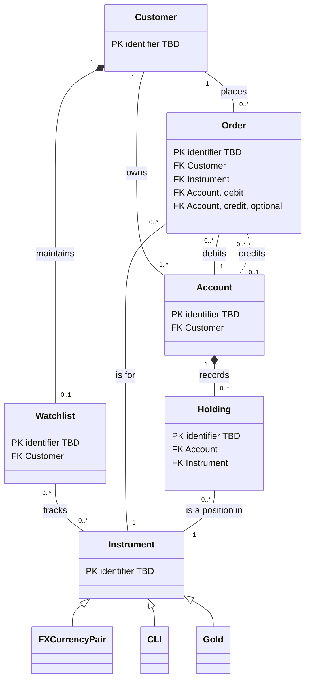

# DBS Product-X (Taiwan) — Wealth Management and Retail Investment

*Moves from broad to narrow: the sector of the domain the product sits in, then this product's scope and data model (entities, keys, relationships, rules), then the systems it works with, then the decisions, assumptions, and open questions behind it. Research-led and validated with the stakeholder; updated as understanding deepens.*

| | |
|---|---|
| **Domain** | Banking |
| **Sector** | Wealth management and retail investment |
| **Client** | DBS |
| **Project Code** | wmtaiwan — PRD: not yet created |
| **Product** | Product-X (temporary name) — digital self-directed investment platform letting customers watch, price, and order foreign exchange (FX), Currency Linked Investments (CLI), and gold. Built federated: one system and code base for all markets, customised per market on demand. In scope: Taiwan booking centre (DBS Taiwan, where the accounts and trades are held); wealth and retail customer segments. |

## Part 1 — Sector

*Specific to the wealth management and retail investment sector of banking, not this project — reusable for other clients in the same sector.*

### 1. Sector Primer

*Plain-language explainer for readers new to the sector: an overview of the sector, its core concepts, how the sector typically models them, and where real implementations commonly differ.*

#### Sector overview

- **Scope:** how banks and wealth firms help individuals grow and protect their savings with investment products and services, beyond everyday deposits and loans. The service ranges from managing the customer's money for them to simply carrying out the customer's own trades. Other parts of banking and finance sit alongside it: everyday retail banking, asset management (making funds), dealing (setting market prices), and insurance [R15][R17].
- **Participants:**
  - *Banks and wealth managers* serve the customer, give advice where offered, and sell investment products.
  - *Customers* are individuals, usually grouped by how much they have to invest [R18].
  - *Product makers* create what is sold — asset managers make funds, issuers create structured products, and the bank's own dealing desk quotes prices for currencies and gold [R1][R15].
  - *Custodians* keep customers' investments safe and record who owns what [R20].
  - *Regulators* set the rules for selling investments to the public [R9][R21].
- **Core transactions:**
  - The customer moves money from a deposit account into an investment.
  - The bank quotes a price, carries out the order, moves the money and the investment between accounts, and records what the customer now holds.
  - The bank earns from fees on the amount invested, commissions on each trade, and the gap between its buying and selling prices [R1][R2][R19].

#### Core concepts

- **Who takes part**
  - **Customer segments.** Banks group customers by how much they have to invest — for example mass retail, affluent, and high net worth — and offer more products and more personal service as wealth rises. The cut-off amounts differ from bank to bank [R18].
  - **Advice or do-it-yourself.** A bank can manage the money for the customer, recommend investments for the customer to choose from, or only carry out orders the customer decides on (*execution-only*). The less advice the bank gives, the fewer checks it must make on whether a product suits the customer — but it must tell the customer it isn't judging that for them [R17].
  - **How the bank earns.** Banks earn fees on the value of what customers invest, commissions on each trade, and a *spread* — the gap between the price at which they buy and the price at which they sell [R1][R19].
- **What is sold**
  - **Deposit or investment.** A deposit is protected up to an insured limit if the bank fails. An investment can earn more, but its value can fall, and deposit insurance doesn't cover it [R16]. *In Taiwan:* deposits in New Taiwan dollars (TWD) and foreign currency are insured up to NT$3 million, paid out in TWD; gold accounts are investments and aren't insured [R3][R24][R25].
  - **Simple to complex products.** Products range from simple ones, such as foreign currency and funds, to complex ones, such as *structured products* whose return is linked to something else. A dual-currency investment, for example, pays higher interest but may repay the money in another currency at a loss [R5][R6]. Because complex products are harder to understand, regulators require extra checks and clearer disclosure before selling them [R22].
- **From order to holding**
  - **Buy and sell prices.** For currencies and gold, the bank quotes two prices: what it pays when the customer sells, and what it charges when the customer buys. The difference is the bank's spread, already built into the quote [R1][R2].
  - **Orders.** A *market order* is carried out straight away at the current quoted price. A *limit order* is carried out only if the price reaches the customer's target within a chosen period, and isn't guaranteed to happen [R1][R2][R11].
  - **Settlement and holdings.** After a trade, money and the investment move between the customer's accounts — this is *settlement*. What the customer then owns is a *holding*, whose value moves with the market, giving a profit or loss against what was paid [R2][R3].
  - **Safekeeping.** Investments a bank holds for customers are kept separate from the bank's own assets and recorded as belonging to the customer, so the bank's creditors can't claim them [R20].
- **Protecting investors**
  - **Suitability and disclosure.** Before selling an investment, the bank checks the customer's risk appetite, knowledge, and experience against the product's risk (*know your customer, know your product*), and explains the risks in writing [R21][R22][R23]. *In Taiwan:* banks must carry out these checks, and non-professional customers can buy only approved types of structured product [R9][R10].
  - **Currency reporting.** Some markets track large conversions between the home currency and foreign currency. *In Taiwan:* conversions between TWD and foreign currency of NT$500,000 or more must be declared to the central bank through the bank, and each individual has an annual limit of USD 5 million before extra checks apply [R7][R8].

#### How the sector typically models this

- **One order record, several types.** Market or limit, and how long the order stays open, are details of one order, not separate objects. Standard trading messages call that period *time in force* [R11].
- **Order stages kept as a status.** An order is accepted or rejected, then executed, cancelled, or expired, and finally settled; each stage is a status with its date on the order [R1][R2][R11].
- **Limit orders carry two rates.** The *trigger rate* decides whether the order goes through; the *transaction rate* is the rate the conversion is done at. The difference between them is the bank's fee [R2].
- **Money set aside for open orders.** When a limit order is accepted, the amount to be sold is set aside on the customer's account (*earmarked*) so it can't be spent elsewhere, and released if the order is cancelled or expires [R2].
- **Products listed as instruments.** Currency pairs, structured investments, and gold are listed as tradeable *instruments*, each with its own terms — the two currencies for a pair; the strike rate, term, and fixing date for a dual-currency investment; the unit and pricing currency for gold [R3][R5].
- **Holdings kept against accounts.** A holding is the quantity of an instrument recorded on a customer's account; the account is debited and credited when orders settle [R2][R3].
- **The watchlist belongs to the customer.** A watchlist is a list of instruments the customer chooses to follow, with live prices and charts, often with a limit on its size [R1].
- **Prices and calendars come from elsewhere.** Live prices, chart history, and trading hours are supplied by other systems rather than owned by the investment app [R1][R7].

#### Common variations / design choices

- **Order types offered:** market and limit only vs. also stop-loss, *one-cancels-other* (two linked orders where filling one cancels the other), and chained orders (one placed only after another is filled) [R2][R12].
- **How long a limit order stays open:** until a chosen date vs. until cancelled vs. until the end of the day [R11].
- **Which conversions allow limit orders:** between foreign currencies and gold only vs. any pair, including the home currency [R1][R2].
- **Gold unit and pricing currency:** ounces priced in US dollars vs. grams priced in the local currency [R3][R13][R14].
- **Watchlist:** one list per customer vs. several named lists; currencies and metals together vs. separate.

*This product's choices on these variations are recorded in Decisions & Assumptions.*

## Part 2 — Product

*Specific to this product: its scope, entities, keys, relationships, and rules.*

### 2. Scope & Context

| Field | Value |
|---|---|
| End Users / Personnel | DBS Taiwan wealth and retail customers, trading currency for speculative purposes, seeking to profit from exchange rate movements |
| Journeys & Use Cases | **Retail Investment:** check and view the watchlist; place orders — market or limit; check profit & loss; view historical charts |
| Inputs | Investment prices, market prices, and order quantity, for investment reference |
| Outputs / Ultimate Outcomes | Order placed |
| Out of Scope | Customer onboarding, account opening, and know-your-customer (KYC) checks and risk profiling; core banking posting, balances, and settlement; investment booking, custody, and statements; price formation and liquidity provision; regulatory filing with the Central Bank; physical gold withdrawal (A9) |
| Constraints | Taiwan booking centre only; FX declaration for TWD settlements of NT$500,000 or more; suitability and product-type limits for non-professional customers; Taiwan mandatory disclosures and compliance checks, with regulatory requirements defined and validated by DBS |

*Which system supplies each input, data ownership, and data flows are in System Landscape.*

### 3. Entities Inventory

#### Tier 1 — Entities

*Independent entities with their own identity and lifecycle.*

| ID | Entity Name | Description | Source Type | Status |
|---|---|---|---|---|
| E01 | Customer | A DBS Taiwan wealth or retail customer who invests through Product-X | Interview; Research [R2][R9] | Confirmed |
| E02 | Account | A customer account debited or credited by orders — TWD deposit account, foreign currency current account, or gold account | Interview; Research [R2][R3] | Confirmed |
| E03 | Instrument | A tradeable investment: an FX currency pair, a CLI, or gold | Interview; Research [R1][R3][R4] | Confirmed |
| E04 | Order | A customer instruction to buy or sell an instrument, market or limit, tracked through its lifecycle including execution | Interview; Research [R1][R2] | Confirmed |

#### Tier 2 — Sub-entities

*Entities with their own identity and lifecycle that cannot exist without their parent.*

| ID | Sub-entity Name | Parent Entity | Description | Source Type | Status |
|---|---|---|---|---|---|
| E01.1 | Watchlist | E01 Customer | The customer's list of instruments to monitor | Interview; Research [R1] | Confirmed |
| E02.1 | Holding | E02 Account | The quantity of an instrument held in the account, the basis for profit & loss | Interview; Research [R2][R3] | Confirmed |

### 4. Domain Model Diagram

*Entities with their keys only — PK = primary key, FK = foreign key (referenced entity shown); other attributes are listed in Attributes. "identifier TBD" = not yet captured (OQ 1). Solid lines = confirmed relationships; dashed lines = assumed (†, see Decisions & Assumptions). Subtype arrows (`<|--`) come from Entity Taxonomy; diamond links (`*--`) run from a parent to its sub-entity.*

### 5. Entity Taxonomy

*Subtype (is-a) hierarchies.*

| Parent Entity | Subtype Entity | Distinguishing Rule | Source Type | Status |
|---|---|---|---|---|
| Instrument | FX Currency Pair | Spot conversion between two currencies, quoted as a buy/sell rate | Interview; Research [R1][R2] | Confirmed |
| Instrument | CLI | Dual-currency investment with a strike rate, term (tenor), fixing and maturity dates, and alternate currency; whether each deal is its own instrument is open (OQ 5) | Interview; Research [R4][R5] | Confirmed |
| Instrument | Gold | Gold held as a balance in a gold account rather than as specific bars (unallocated), quoted per unit in a pricing currency | Interview; Research [R2][R3] | Confirmed |

### 6. Attributes

*One line per entity. PK = primary key; types and descriptions are given only where not obvious from the name. Foreign keys follow from Relationships. Identifiers not yet captured for Customer, Account, Instrument, Order, Watchlist, and Holding (OQ 1).*

- **E01 Customer** — `name` · `national ID number` · `segment` (Wealth / Retail) · `investor classification` (professional / general; A4) · `risk profile` (A4; OQ 4)
- **E02 Account** — `account type` (TWD deposit / foreign currency current account / gold) · `currency` · `available balance` · `earmarked amount` (C3)
- **E03 Instrument** — `instrument type` (FX / CLI / Gold; C5) · `trading hours` (OQ 7) · `limit order allowed` (C2, A2)
  - *FX Currency Pair* — `base currency` · `quote currency` · `buy rate` · `sell rate` (streamed, include spread)
  - *CLI* — `investment currency` · `alternate currency` · `strike rate` · `tenor` · `yield` · `fixing date` · `maturity date` · `minimum amount` (deal-level terms may move to Order or Holding; OQ 5)
  - *Gold* — `unit` (ounce; A3) · `pricing currency` (USD; A3) · `buy price` · `sell price`
- **E04 Order** — `order type` (Market / Limit; C1) · `side` (buy / sell) · `quantity` · `trigger rate` (limit only) · `transaction rate` (limit only) · `executed rate` · `valid-until date` (limit only; A1) · `status` (C4) · `placed at` · `trade date` · `settlement date`
- **E01.1 Watchlist** — `instruments` (list; A5)
- **E02.1 Holding** — `quantity` · `cost basis` · `market value` · `profit & loss` (OQ 2)

### 7. Relationships

*Grouped by area. Each relationship reads left to right, followed by its cardinality as **A : B** — how many A relate to one B, then how many B relate to one A. † = assumed, not yet confirmed (see Decisions & Assumptions).*

**Cardinality notation:** `1` = exactly one · `0..1` = zero or one · `1..*` = one or more · `0..*` = zero or more

- **Customer and accounts**
  - Customer → **owns** → Account `1 : 1..*` — joint accounts not modelled (A6)
- **Monitoring**
  - Customer → **maintains** → Watchlist `1 : 0..1` — sub-entity of Customer (D7); one watchlist per customer (D5)
  - Watchlist → **tracks** → Instrument `0..* : 0..*` — size cap not yet known (A5)
- **Ordering**
  - Customer → **places** → Order `1 : 0..*`
  - Order → **is for** → Instrument `0..* : 1`
  - Order → **debits** → Account `0..* : 1` — the account the sold amount comes from and is earmarked on
  - Order → **credits** → Account `0..* : 0..1` † — the account the bought amount goes to; none until a CLI matures (A7)
- **Holdings**
  - Account → **records** → Holding `1 : 0..*` — sub-entity of Account (D7); which account holds CLI (A8)
  - Holding → **is a position in** → Instrument `0..* : 1` — reference to what is held, not a parent (D7)
  - Customer → **holds** → Holding `1 : 0..*` — derived, not stored (via Account)

### 8. Business Rules / Constraints

*Structural constraints governing entity existence, mandatory relationships, cardinality minimums, mutual exclusivity, and allowed states.*

| ID | Constraint | Entities Involved | Description | Source Type | Status |
|---|---|---|---|---|---|
| C1 | Limit fields only on limit orders | Order | A Limit order must have a trigger rate, transaction rate, and valid-until date; a Market order has none of them | Research [R1][R2] | Proposed |
| C2 | Limit orders only between foreign currencies or gold | Order, Instrument, Account | A limit order cannot involve a TWD conversion; it must sell and buy foreign currency or gold | Research [R2] | Proposed |
| C3 | Earmark on acceptance | Order, Account | Accepting a limit order requires a sufficient balance on the debit account and earmarks the sold amount; the earmark is released when the order is cancelled, expires, or is not executed | Research [R2] | Proposed |
| C4 | Allowed order states | Order | Accepted or Rejected; an Accepted order becomes Executed, Cancelled, or Expired; an Executed order becomes Settled | Research [R1][R2] | Proposed |
| C5 | One instrument type | Instrument | Each instrument is exactly one of FX Currency Pair, CLI, or Gold | Interview | Confirmed |
| C6 | Own accounts only | Order, Account, Customer | An order's debit and credit accounts must belong to the customer who places it | Research [R1] | Proposed |
| C7 | One watchlist per customer | Watchlist, Customer | A customer has at most one watchlist | Interview | Confirmed |

## Part 3 — System Landscape

*Specific to how the product is realised: the systems it interacts with, which data each owns, and how data flows between them. Systems and data flows only — integration detail beyond the type of integration is platform architecture.*

### 9. System Landscape

#### Systems

*Entities owned by an out-of-scope system are modelled as read-only reflections of that system. † = assumed, not yet confirmed (see Decisions & Assumptions).*

| System | Role | In Scope? | System of Record For |
|---|---|---|---|
| Product-X | Customer-facing investment platform: watchlist, pricing display, charts, order capture, profit & loss view; one federated system and code base for all markets, customised per market on demand | Yes | Watchlist (A10) |
| CRM | Customer relationship and profile data | No — integration only | Customer (A10) |
| Finacle | Core banking: deposit, foreign currency, and gold accounts; balances, earmarks, postings | No — integration only | Account (A10) |
| Avaloq | Wealth and investment platform: investment instruments, holdings, order booking | No — integration only | Instrument, Holding, Order (A10) |
| Pricing source | Live rates and historical prices | ? (OQ 3) | — |

#### Data flows

*Direction is relative to Product-X. Integration types are not yet documented — the statement of work names orchestration APIs only — and are unconfirmed until the technical team checks them. ? = not yet known.*

- **Upstream — into Product-X**
  - CRM → Product-X: Customer (segment, investor classification, risk profile) † — `?`
  - Finacle → Product-X: Account (balances, earmarks) † — `?`
  - Avaloq → Product-X: Instrument, Holding, Order status † — `?`
- **Downstream — out of Product-X**
  - Product-X → Finacle: FX orders — debits, credits, earmarks † — `?`
  - Product-X → Avaloq: CLI and gold orders † — `?`
- **Unclear**
  - Product-X ↔ pricing source: live rates and chart history are needed; the system and owner are not named (OQ 3)

## Part 4 — Supporting Information

*The decisions and assumptions behind the model, open items, sources, and document history.*

### 10. Decisions & Assumptions

*Decided: modelling choices made where industry practice varies — what was decided, and why. Assumptions: what the model currently treats as true without confirmation — what is assumed, and what would confirm it.*

#### Decided

- **D1 — The model holds only the six entities on the core retail investment journey**, rather than also modelling rate quotes, price history, trading calendar, risk profile, disclosure acknowledgement, and FX declaration as entities.
  *Why:* stakeholder — those candidates are not focused on the core retail investment journey, and some (e.g. FX declaration) have no lifecycle of their own, or none closely related to that journey.
- **D2 — Market and Limit are values of the order's type**, rather than separate entities.
  *Why:* stakeholder — they are attributes of order type, not entities themselves.
- **D3 — Execution is a stage of the Order's lifecycle**, rather than a separate Execution entity.
  *Why:* stakeholder — execution is a phase of the order lifecycle.
- **D4 — Instrument is one entity with FX Currency Pair, CLI, and Gold as subtypes**, rather than three separate instrument entities.
  *Why:* stakeholder, accepting the proposed reason — Order, Watchlist, and Holding each relate to a single Instrument instead of three alternatives.
- **D5 — One watchlist per customer**, rather than several named lists or separate FX and gold lists.
  *Why:* stakeholder — only the Taiwan market is in scope, with one watchlist per customer there.
- **D6 — Market (booking centre) is not an entity**, rather than an entity carrying per-market products, rules, and calendars.
  *Why:* stakeholder — only the Taiwan market is in scope.
- **D7 — Watchlist is a sub-entity of Customer and Holding a sub-entity of Account, with Account as Holding's only parent**, rather than standalone entities or Holding also owned by Instrument.
  *Why:* stakeholder — each has its own identity and lifecycle but can't exist without its parent; an instrument is what is held, not what possesses the holding.

#### Assumptions

- **A1 — A limit order is good-till-date, lapsing at 17:00 on the chosen date (same-day orders placed before 16:00), with the maximum period set by the system.**
  *Confirm:* DBS business — basis is DBS Taiwan's FX and gold limit order agreement [R2].
- **A2 — Limit orders apply to FX and gold; CLI orders are market-type subscriptions only.**
  *Confirm:* DBS business — the statement of work lists limit orders for FX only, while DBS Taiwan's agreement also allows gold limit orders [R2].
- **A3 — Gold is quoted per ounce in USD, to two decimal places, with a minimum purchase of one ounce.**
  *Confirm:* DBS business — basis is DBS Taiwan's gold account terms [R3]; other Taiwan banks quote per gram in TWD [R13].
- **A4 — Customer investor classification and risk profile are read by Product-X to gate CLI orders, but are not owned by it.**
  *Confirm:* DBS compliance — basis is Taiwan suitability rules [R9][R10] and D1.
- **A5 — The watchlist holds FX and gold instruments together, with a size cap.**
  *Confirm:* DBS business — the statement of work lists FX and gold watchlists separately; a comparable bank caps at 20 pairs [R1].
- **A6 — Each account has one owning customer; joint accounts are not in scope.**
  *Confirm:* DBS business — no source covers joint accounts.
- **A7 — An order credits one account on settlement; a CLI credits its account only at maturity, in the investment or alternate currency.**
  *Confirm:* DBS business — basis is CLI mechanics [R5].
- **A8 — Foreign currency and gold holdings sit in their own currency and gold accounts; CLI holdings sit in the account the investment was placed from.**
  *Confirm:* DBS technology — basis is DBS Taiwan's account terms [R2][R3].
- **A9 — The product boundary in Scope & Context (onboarding, KYC, core banking, booking and custody, pricing, regulatory filing, physical gold) sits outside Product-X.**
  *Confirm:* DBS business — proposed from research and the named systems.
- **A10 — System-of-record assignments and all data flows are as shown in System Landscape.**
  *Confirm:* DBS technology team — systems named by the stakeholder; ownership and flows inferred from their usual roles.

### 11. Open Questions

*Anything unresolved with no working answer yet.*

1. **Identifiers:** What uniquely identifies each entity — Customer, Account, Instrument, Order, Watchlist, Holding — and which system assigns each key?
2. **Profit & loss:** How is profit & loss calculated — realised (on sales) vs. unrealised (on paper), how the purchase cost is worked out, and in which currency it is shown — and does Holding store it or derive it from prices?
3. **Pricing source:** Which system supplies live rates, gold prices, and chart history, and which executes orders against them?
4. **Regulatory features:** Which system holds the Taiwan risk profile, disclosure acknowledgements, and FX declarations (NT$500,000+) that Product-X checks, and what does Product-X record of each check?
5. **CLI instrument:** Is a CLI instrument the offer (currency pair + tenor), with strike, fixing, maturity, and yield on the Order or Holding — or is each customer's deal its own instrument?
6. **CLI lifecycle:** Does Product-X cover only CLI placement, or also fixing, maturity, and the conversion outcome?
7. **Trading hours:** Are trading hours and calendar overrides attributes of the instrument, or configuration held by another system?
8. **Market code:** With one federated code base for all markets, do Customer, Account, Instrument, and Order carry a market code even while only Taiwan is in scope?
9. **Order system of record:** System Landscape makes Avaloq the system of record for Orders, but FX orders flow to Finacle and only CLI and gold orders to Avaloq. Which system owns FX orders?
10. **CLI journey:** Journeys & Use Cases lists no CLI step, while the model includes CLI as an instrument and A2 treats CLI orders as subscriptions. Is subscribing to a CLI an in-scope use case?

### 12. Reference Sources

*Sources cited as [R#] in this document.*

- **R1** [DBS Hong Kong — FX Online Trading Platform](https://www.dbs.com.hk/personal/investments/foreign-currencies/fx-online-trading-platform)
- **R2** [DBS Taiwan — 外幣即期匯率設定交易約定書 (FX and gold limit order agreement)](https://dbs.com.tw/iwov-resources/pdf/Latest%20News/latest_news_20230325.pdf)
- **R3** [DBS Taiwan — 個人金融開戶總約定書 黃金帳戶約定事項 revision (gold account terms)](https://www.dbs.com.tw/iwov-resources/pdf/LatestNews/GeneralAgreement_AccountOpening_250626.pdf)
- **R4** [DBS Taiwan — 外幣組合投資與黃金外幣組合投資 (dual currency investments, personal banking)](https://www.dbs.com.tw/personal-zh/investments/sip/dual-current-investment)
- **R5** [DBS Singapore — Currency Linked Investments](https://www.dbs.com.sg/treasures/investments/product-suite/fx-and-cash-management/currency-linked-investments)
- **R6** [DBS Hong Kong — Currency Linked Investment Important Facts Statement](https://www.dbs.com.hk/iwov-resources/pdf/appforms/investments/CLI-IFS-Eng_202209.pdf)
- **R7** [DBS Taiwan — 星展大額換匯 (online large-amount FX exchange and declaration, personal banking)](https://www.dbs.com.tw/personal-zh/investment/fx_onlinefunction/index.html)
- **R8** [Invest Taiwan — Bravo! Taiwan 2024, foreign exchange settlement](https://investtaiwan.nat.gov.tw/eBook/BravoTaiwan/2024ebook_en/files/basic-html/page55.html)
- **R9** [Taipei Times — banks told to improve KYC and KYP practices (2022)](https://www.taipeitimes.com/News/biz/archives/2022/04/05/2003776011)
- **R10** [Taishin Bank — bank-issued structured products for individual customers](https://www.taishinbank.com.tw/TSB/personal/investment/structure/structured-products-bank-issue/TSBankGridPage-000094-00001/)
- **R11** [FIX Trading Community — FIX 5.0 SP2 TimeInForce (tag 59)](https://fiximate.fixtrading.org/legacy/en/FIX.5.0SP2/tag59.html)
- **R12** [Citibank Hong Kong — FX Order Watching Service](https://www.citibank.com.hk/english/investment/fx-order-watching-service.html)
- **R13** [Bank of Taiwan — gold passbook rates](https://rate.bot.com.tw/gold?Lang=zh-tw)
- **R14** [Taishin Bank — gold account know-how](https://www.taishinbank.com.tw/TSB/personal/investment/more-invest-products/gold-account/gold-account-know-how/)
- **R15** [Umbrex — Asset & wealth management industry primer](https://umbrex.com/resources/industry-primers/financial-services-industry-primers/asset-wealth-management-industry-primer/)
- **R16** [FDIC — Financial products that are not insured](https://www.fdic.gov/resources/deposit-insurance/financial-products-not-insured)
- **R17** [MFSA — Types of investment services](https://www.mfsa.mt/consumers/investments/types-of-investment-services/)
- **R18** [Private Banker International — Find the mother lode](https://www.privatebankerinternational.com/news/find-the-mother-lode/)
- **R19** [The Digital Banker — Banks' wealth-management heyday may have passed](https://thedigitalbanker.com/banks-wealth-management-heyday-may-have-passed/)
- **R20** [U.S. Bank — The role of bank custodians](https://www.usbank.com/corporate-and-commercial-banking/insights/institutional/custody/role-of-bank-custodians.html)
- **R21** [IOSCO — Suitability requirements with respect to the distribution of complex financial products (2013)](https://www.iosco.org/library/pubdocs/pdf/IOSCOPD400.pdf)
- **R22** [IOSCO — Regulation of retail structured products, final report](https://www.iosco.org/library/pubdocs/pdf/ioscopd434.pdf)
- **R23** [MAS — Notice SFA 04-N12 on the sale of investment products](https://www.mas.gov.sg/regulation/notices/notice-sfa-04-n12)
- **R24** [Central Deposit Insurance Corporation (Taiwan) — 存款保險常見問答 (deposit insurance FAQ)](https://www.cdic.gov.tw/main_deposit/faq.aspx?uid=59&pid=59)
- **R25** [UOB Taiwan — Depositor rights](https://www.uobgroup.com/tw/disclosure/depositor-rights.page)

### 13. Document Control & Revision History

| Field | Value |
|---|---|
| Status | Draft |

**Revision History**

| Version | Date | Change Description |
|---|---|---|
| 1.0 | 2026-10-20 | Initial research-led domain analysis for the Taiwan retail investment journey (FX, CLI, gold); federation defined; Watchlist and Holding as tier-2 sub-entities |
| 2.0 | 2026-10-21 | Keyed to wmtaiwan; file renamed; Part 1 rebuilt as sector, re-researched, in plain language; review fixes; OQ 9–10 added; sources upgraded |
