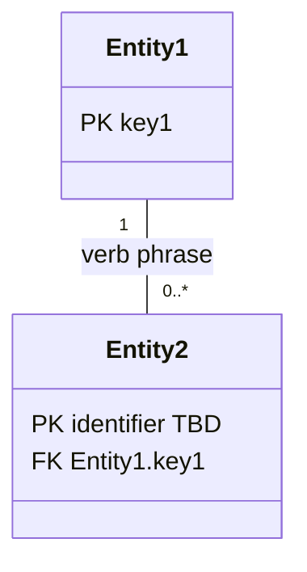

# {{Client}} {{Product}} ({{scope, e.g. region}}) — {{Domain}}

*Moves from broad to narrow: the industry domain, then this product's scope and data model (entities, keys, relationships, rules), then the systems it works with, then the decisions, assumptions, and open questions behind it. Research-led and validated with the stakeholder; updated as understanding deepens.*

| | |
|---|---|
| **Domain** | {{industry / business domain}} |
| **Client** | {{client name, or "Not disclosed"}} |
| **Product** | {{product (short name)}} — {{one-line description}}. In scope: {{boundaries, e.g. deployment, region, product line}}. |

## Part 1 — Domain

*Specific to the industry, not this project — reusable for other clients in the same domain.*

### 1. Domain Primer

*Plain-language explainer for readers new to the domain: the core concepts, how the industry typically models them, and where real implementations commonly differ.*

#### Core concepts

- **{{concept}}.** {{explanation}} [R#]

#### How the industry typically models this

- **{{summary}}.** {{explanation}} [R#]

#### Common variations / design choices

- **{{topic}}:** {{option}} vs. {{option}}.

*This product's choices on these variations are recorded in Decisions & Assumptions.*

## Part 2 — Product

*Specific to this product: its scope, entities, keys, relationships, and rules.*

### 2. Scope & Context

| Field | Value |
|---|---|
| End Users / Personnel | {{who uses or operates the process}} |
| Journeys & Use Cases | {{each in-scope journey with its high-level use cases, one journey per line, separated by ` ` — e.g. **Account Opening:** apply for an account; verify identity **Claims:** submit a claim; track its status}} |
| Inputs | {{what enters the process — triggers, requests, data}} |
| Outputs / Ultimate Outcomes | {{what the process produces or achieves}} |
| Out of Scope | {{...}} |
| Constraints | {{regulatory, regional, product-line boundaries}} |

*Which system supplies each input, data ownership, and data flows are in System Landscape.*

### 3. Entities Inventory

| ID | Entity Name | Description | Source Type | Status |
|---|---|---|---|---|
| E01 | {{...}} | {{...}} | {{Doc: <file §> / Interview / Research [R#]}} | {{Confirmed / Proposed}} |

### 4. Domain Model Diagram

*Entities with their keys only — PK = primary key, FK = foreign key (referenced entity shown); other attributes are listed in Attributes. "identifier TBD" = not yet captured (OQ {{n}}). Solid lines = confirmed relationships; dashed lines = assumed (†, see Decisions & Assumptions). Subtype arrows (`<|--`) come from Entity Taxonomy, if present.*

### 5. Entity Taxonomy

*Subtype (is-a) hierarchies.*

| Parent Entity | Subtype Entity | Distinguishing Rule | Source Type | Status |
|---|---|---|---|---|
| {{...}} | {{...}} | {{...}} | {{...}} | {{...}} |

### 6. Attributes

*One line per entity. PK = primary key; types and descriptions are given only where not obvious from the name. Foreign keys follow from Relationships. Identifiers not yet captured for {{entities}} (OQ {{n}}).*

- **{{E01}} {{Entity Name}}** — `{{attribute}}` (PK; {{short note}}) · `{{attribute}}` · `{{attribute}}` ({{type or note}})

### 7. Relationships

*Grouped by area. Each relationship reads left to right, followed by its cardinality as **A : B** — how many A relate to one B, then how many B relate to one A. † = assumed, not yet confirmed (see Decisions & Assumptions).*

**Cardinality notation:** `1` = exactly one · `0..1` = zero or one · `1..*` = one or more · `0..*` = zero or more

- **{{Area, e.g. Orders}}**
  - {{Entity A}} → **{{verb phrase}}** → {{Entity B}} `{{e.g. 1 : 1..*}}` — {{short qualifier, if any}}

### 8. Business Rules / Constraints

*Structural constraints governing entity existence, mandatory relationships, cardinality minimums, mutual exclusivity, and allowed states.*

| ID | Constraint | Entities Involved | Description | Source Type | Status |
|---|---|---|---|---|---|
| C1 | {{...}} | {{...}} | {{...}} | {{...}} | {{...}} |

## Part 3 — System Landscape

*Specific to how the product is realised: the systems it interacts with, which data each owns, and how data flows between them. Systems and data flows only — integration detail beyond the type of integration is platform architecture.*

### 9. System Landscape

#### Systems

*Entities owned by an out-of-scope system are modelled as read-only reflections of that system. † = assumed, not yet confirmed (see Decisions & Assumptions).*

| System | Role | In Scope? | System of Record For |
|---|---|---|---|
| {{system name}} {{† if unconfirmed}} | {{what it does in the process}} | {{Yes / No — integration only / ? (OQ n)}} | {{entities or data it owns, or "—"; add (A#) if assumed}} |

#### Data flows

*Direction is relative to {{product}}. Integration types come from {{source document}} and are unconfirmed until the technical team checks them. ? = not yet known.*

- **Upstream — into {{product}}**
  - {{System}} → {{product}}: {{entities or data received}} — `{{integration type, if documented}}`
- **Downstream — out of {{product}}**
  - {{product}} → {{System}}: {{entities or data sent}} — `{{integration type, if documented}}`
- **Unclear**
  - {{product}} ↔ {{System}}: {{what is known, and what is not}} (OQ {{n}})

## Part 4 — Supporting Information

*The decisions and assumptions behind the model, open items, sources, and document history.*

### 10. Decisions & Assumptions

*Decided: modelling choices made where industry practice varies — what was decided, and why. Assumptions: what the model currently treats as true without confirmation — what is assumed, and what would confirm it.*

#### Decided

- **D1 — {{what was decided}}**, rather than {{the alternative}}.
  *Why:* {{the reason, with its source}}

#### Assumptions

- **A1 — {{what the model assumes}}.**
  *Confirm:* {{who or what would confirm it, and the current basis}}

### 11. Open Questions

*Anything unresolved with no working answer yet.*

1. **{{topic}}:** {{question}}

### 12. Reference Sources

*Sources cited as [R#] in this document.*

- **R1** [{{title}}]({{URL}})

### 13. Document Control & Revision History

| Field | Value |
|---|---|
| Status | Draft / In Review / Approved |

**Revision History**

| Version | Date | Change Description |
|---|---|---|
| 1.0 | {{date}} | {{e.g., "Initial research-led domain analysis for <scope>"}} |
