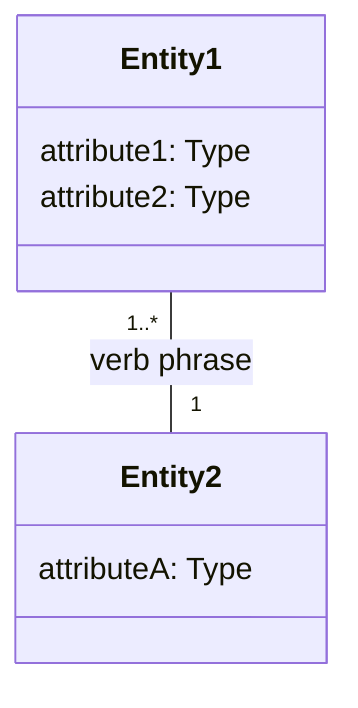

# Product Domain Model

*A single, cumulative, product-wide ontology of business entities, their attributes, relationships, hierarchy, and structural constraints. Updated incrementally as features are added or analyzed.*

## 1. Document Control & Revision History

| Field | Value |
|---|---|
| Status | Draft / In Review / Approved |

**Revision History**

| Version | Date | Feature/Project Code | Change Description |
|---|---|---|---|
| 1.0 | {{date}} | {{feature(s)}} | {{e.g., "Initial domain model seeded from <feature>"}} |

## 2. Entities Inventory

*Each entity is listed exactly as named per its source document. Entities are never merged across sources unless explicitly confirmed, even if names are similar or may refer to the same concept — possible duplicates are flagged as Open Questions instead. This preserves the exact terminology used across the business.*

| Entity Name | Description | Source(s) |
|---|---|---|
| {{...}} | {{...}} | {{e.g., "PRD: Key Features Overview"; "UC-02 Basic Flow"; "Feature Analysis: Stakeholders table"}} |

## 3. Entity Taxonomy

*Subtype hierarchies (is-a relationships) are included only when a source document explicitly names subtypes. Never inferred speculatively. If empty, leave this section or remove it entirely — do not add placeholders.*

| Parent Entity | Subtype Entity | Distinguishing Rule | Source |
|---|---|---|---|
| {{...}} | {{...}} | {{...}} | {{e.g., "UC-01 Basic Flow mentions 'customer types: individual vs. corporate'"}} |

## 4. Attributes

*Data properties per entity, extracted from flow/rule prose detail (e.g., "system records order date" → `Order.orderDate`). Grouped and sorted by entity. Each attribute is sourced to the flow step, rule, or other section where it was evidenced.*

| Entity | Attribute | Description | Source |
|---|---|---|---|
| {{...}} | {{...}} | {{...}} | {{e.g., "UC-03 Basic Flow step 2"}} |

## 5. Relationships

*Object properties linking two entities. Each row includes the verb phrase describing the relationship and the cardinality. Cardinality that is not explicit in source text is marked with a note for confirmation rather than asserted silently.*

| Entity A | Relationship (verb phrase) | Entity B | Cardinality | Source |
|---|---|---|---|---|
| {{...}} | {{...}} | {{...}} | {{e.g., "1..*"; "0..1"; "??" if unconfirmed}} | {{e.g., "UC-03 Basic Flow"}} |

## 6. Domain Model Diagram

*A Mermaid class diagram combining entities with brief attribute lists, relationships (verb-labeled, cardinality-labeled), and subtype arrows (`<|--`) for any taxonomy from section 3.*

## 7. Business Rules / Constraints

*Structural constraints on entities — constraints that govern entity existence, mandatory relationships, cardinality minimums, mutual exclusivity, etc. Explicitly distinct from Feature Analysis's process-level Business Rules table (which captures operational/workflow rules). If empty, leave this section or remove it entirely — do not add placeholders.*

| Constraint | Entities Involved | Description | Source |
|---|---|---|---|
| {{...}} | {{...}} | {{...}} | {{e.g., "Feature Analysis: To-Be Business Rules; 'An Order must have at least one LineItem'"}} |

## 8. Open Questions

*Ambiguous/possibly-duplicate entity names, unconfirmed relationships or cardinalities (marked "?" in Relationships section), unmodeled hierarchy hints, attributes mentioned in source text but never clearly typed/defined, and anything else still unresolved after sourcing and interview.*

{{Unresolved items, including entity name ambiguities flagged for confirmation, cardinalities not explicit in source text, and any structural constraints implied but not formally stated.}}
