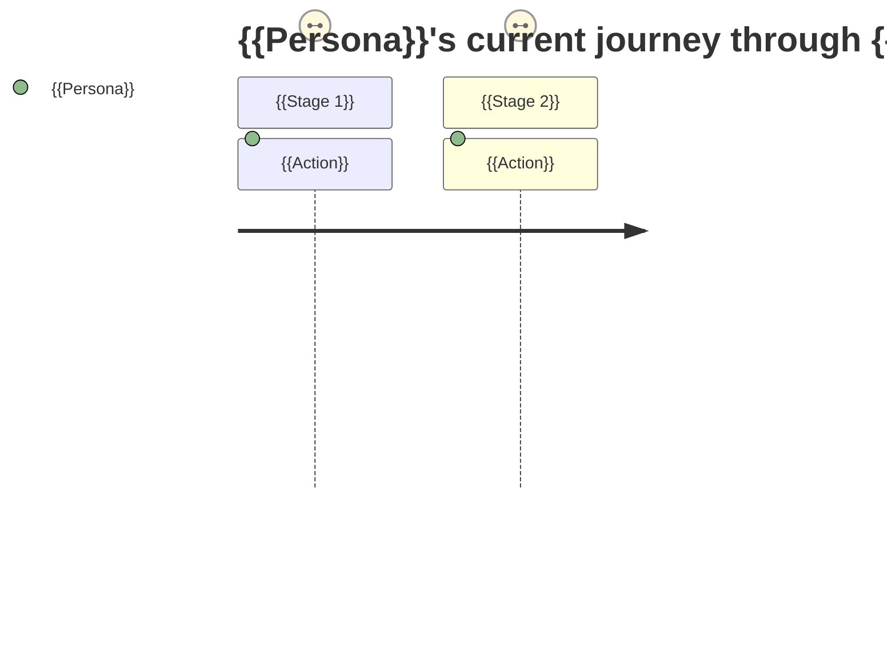
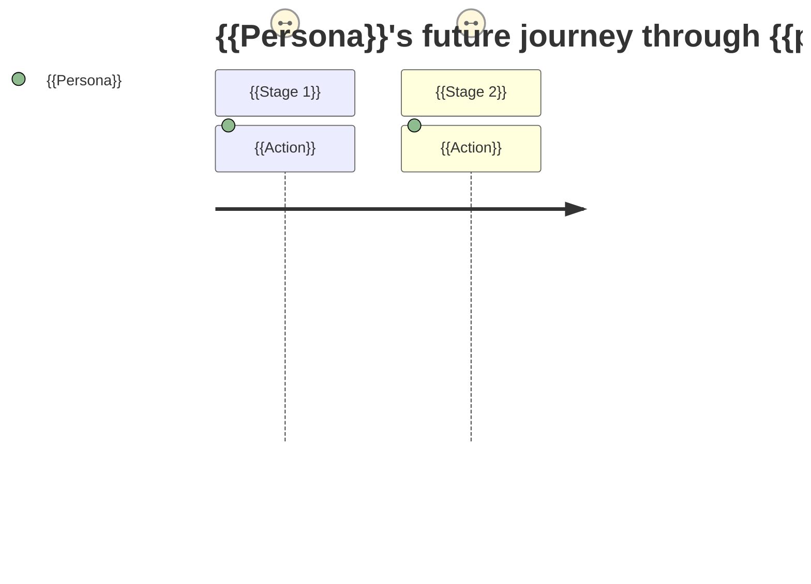

# {{Feature Name}} — As-Is / To-Be Process & Gap Analysis

## 1. Process Overview & Scope

{{Which business process is being analyzed, and its boundaries — what triggers the start of the process, and what marks its end.}}

## 2. Stakeholders / Roles Involved

| Role | Responsibility in this process |
|---|---|
| {{...}} | {{...}} |

## 3. As-Is: Process Description

{{Step-by-step narrative of how the process currently works, in the order it happens today.}}

1. {{Step}}
2. {{Step}}

```mermaid
flowchart TD
    subgraph Role_A[{{Role A}}]
        A1[{{Step}}] --> A2[{{Step}}]
    end
    subgraph Role_B[{{Role B}}]
        B1[{{Step}}]
    end
    A2 --> B1
```

## 4. As-Is: End-to-End User Journey

{{The current process, told from the perspective of a specific user persona — their actions, touchpoints, and systems/channels encountered, stage by stage.}}



## 5. As-Is: Existing Business Rules

{{Rules, policies, validations, and exceptions that currently govern this process.}}

| Rule | Description | Source (policy doc / SOP / stated by role) |
|---|---|---|
| {{...}} | {{...}} | {{...}} |

## 6. As-Is: Systems Involved

| Process Step | System/Tool | Notes |
|---|---|---|
| {{...}} | {{...}} | {{...}} |

## 7. As-Is: Pain Points / Issues

| Pain Point | Process Step(s) Affected | Root Cause (if known) | Who Raised It |
|---|---|---|---|
| {{...}} | {{...}} | {{...}} | {{...}} |

## 8. To-Be: Process Description

{{Step-by-step narrative of how the process should work once the feature/product is delivered.}}

1. {{Step}}
2. {{Step}}

```mermaid
flowchart TD
    subgraph Role_A[{{Role A}}]
        A1[{{Step}}] --> A2[{{Step}}]
    end
    subgraph Role_B[{{Role B}}]
        B1[{{Step}}]
    end
    A2 --> B1
```

## 9. To-Be: End-to-End User Journey



## 10. To-Be: Business Rules

{{New, changed, or removed rules for the future state.}}

| Rule | Description | Change vs. As-Is (New/Modified/Removed) | Source (stakeholder/role) |
|---|---|---|---|
| {{...}} | {{...}} | {{...}} | {{...}} |

## 11. Gap Analysis — As-Is vs. To-Be

*Factual comparison of what differs between the as-is and to-be process.*

| As-Is Step/Rule | To-Be Step/Rule | Change Type (New/Modified/Removed/Unchanged) | Pain Point Addressed |
|---|---|---|---|
| {{...}} | {{...}} | {{...}} | {{...}} |

## 12. Non-Functional Requirements

*Feature-level NFRs; use cases and user stories reference them by ID.*

| NFR ID | Category | Requirement | Source |
|---|---|---|---|
| {{NFR-01}} | {{Performance/Security/Usability/Scalability/Availability/Compliance/Other}} | {{...}} | {{e.g., "As-Is: Current Performance Baseline" / "As-Is: Pain Points" / "stakeholder interview"}} |

## 13. Open Questions

{{Unresolved items.}}

## 14. Document Control & Revision History

| Field | Value |
|---|---|
| Feature / Process Name | {{name}} |
| Project Code | {{project-code}} |
| Related PRD | {{link/path to outputs/<project-code>-PRD.md, or "None"}} |
| Author | {{author}} |
| Status | Draft / In Review / Approved |

**Revision History**

| Version | Date | Change Description | Trigger / Reason |
|---|---|---|---|
| 1.0 | {{date}} | Initial draft | {{e.g., "Initial interviews with process owners"}} |
