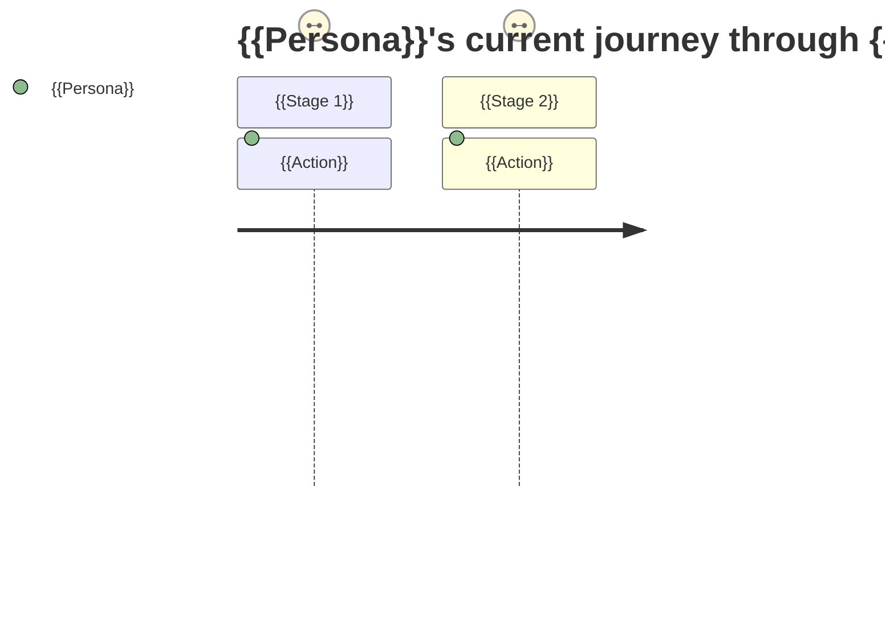
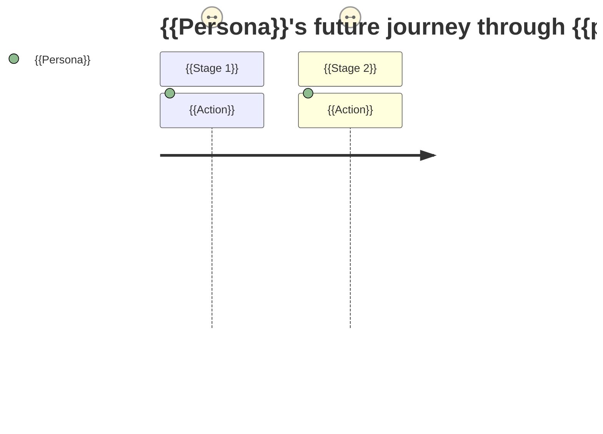

# {{Feature Name}} — As-Is / To-Be Process & Gap Analysis

## 1. Document Control & Revision History

| Field | Value |
|---|---|
| Feature / Process Name | {{name}} |
| Project Code | {{project-code}} |
| Related PRD | {{link/path to outputs/<project-code>-PRD.md, or "None"}} |
| Author | {{author}} |
| Status | Draft / In Review / Approved |

**Revision History**

| Version | Date | Change Description | Trigger / Reason |
|---|---|---|---|
| 1.0 | {{date}} | Initial draft | {{e.g., "Initial interviews with process owners"}} |

## 2. Process Overview & Scope

{{Which business process is being analyzed, and its boundaries — what triggers the start of the process, and what marks its end.}}

## 3. Stakeholders / Roles Involved

| Role | Responsibility in this process |
|---|---|
| {{...}} | {{...}} |

## 4. As-Is: Process Description

{{Step-by-step narrative of how the process currently works, in the order it happens today.}}

1. {{Step}}
2. {{Step}}

```mermaid
flowchart TD
    subgraph Role_A[{{Role A}}]
        A1[{{Step}}] --> A2[{{Step}}]
    end
    subgraph Role_B[{{Role B}}]
        B1[{{Step}}]
    end
    A2 --> B1
```
*Diagram note: one subgraph per role/actor to show handoffs (a lightweight swimlane view). Only include steps confirmed during interview or by a source document.*

## 5. As-Is: End-to-End User Journey

{{The current process, told from the perspective of a specific user persona — their actions, touchpoints, and systems/channels encountered, stage by stage.}}



## 6. As-Is: Existing Business Rules

{{Rules, policies, validations, and exceptions that currently govern this process — as actually practiced today, not as officially documented if the two differ (note both if they diverge).}}

| Rule | Description | Source (policy doc / SOP / stated by role) |
|---|---|---|
| {{...}} | {{...}} | {{...}} |

## 7. As-Is: Systems Involved

| Process Step | System/Tool | Notes |
|---|---|---|
| {{...}} | {{...}} | {{...}} |

## 8. As-Is: Pain Points / Issues

| Pain Point | Process Step(s) Affected | Root Cause (if known) | Who Raised It |
|---|---|---|---|
| {{...}} | {{...}} | {{...}} | {{...}} |

## 9. To-Be: Process Description

{{Step-by-step narrative of how the process should work once the feature/product is delivered, as described by stakeholders during interview — not designed or invented by this document.}}

1. {{Step}}
2. {{Step}}

```mermaid
flowchart TD
    subgraph Role_A[{{Role A}}]
        A1[{{Step}}] --> A2[{{Step}}]
    end
    subgraph Role_B[{{Role B}}]
        B1[{{Step}}]
    end
    A2 --> B1
```
*Diagram note: only include steps a stakeholder actually described as the intended future state.*

## 10. To-Be: End-to-End User Journey



## 11. To-Be: Business Rules

{{New, changed, or removed rules as stated by stakeholders for the future state.}}

| Rule | Description | Change vs. As-Is (New/Modified/Removed) | Source (stakeholder/role) |
|---|---|---|---|
| {{...}} | {{...}} | {{...}} | {{...}} |

## 12. Gap Analysis — As-Is vs. To-Be

{{Factual comparison only — what differs, not how to solve it. Solution/functional design belongs to a later artifact.}}

| As-Is Step/Rule | To-Be Step/Rule | Change Type (New/Modified/Removed/Unchanged) | Pain Point Addressed (only if stakeholder stated it) |
|---|---|---|---|
| {{...}} | {{...}} | {{...}} | {{...}} |

## 13. Non-Functional Requirements

*Feature-level NFRs live here (not duplicated per use case or user story). A use case/user story artifact for this feature references an NFR by ID rather than restating it.*

| NFR ID | Category | Requirement | Source |
|---|---|---|---|
| {{NFR-01}} | {{Performance/Security/Usability/Scalability/Availability/Compliance/Other}} | {{...}} | {{e.g., "As-Is: Current Performance Baseline" / "As-Is: Pain Points" / "stakeholder interview"}} |

## 14. Open Questions

{{Unresolved items, including any conflicts found between interview input and existing documentation, any to-be items stakeholders were unsure about, and any NFR needs raised by a downstream use case/story that aren't yet captured above.}}
